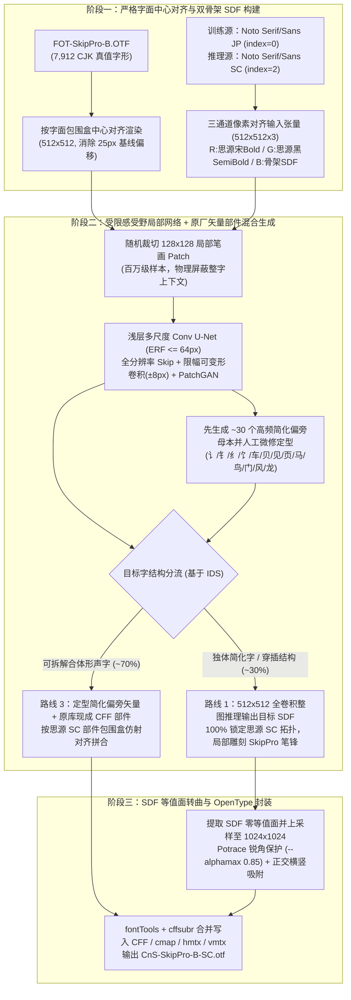

# CnS- 简中字符集扩充与风格迁移技术方案

> [!IMPORTANT]
> **核心目标**：以本仓库 [`FOT-SkipPro-B.OTF`](./FOT-SkipPro-B.OTF) 现有的 **7,912 个原版汉字**为唯一风格真值（Style Ground Truth），仅将**思源宋体 / 思源黑体**作为字形结构参考骨架（Content Skeleton），在**物理级杜绝整字过拟合与偏旁幻觉**的前提下，生成具有完全一致设计语言的简体中文缺失字符与陆标字形，最终矢量化并封装为生产可用的 OpenType 字体。

---

## 1. 基底字体（`FOT-SkipPro-B.OTF`）逆向解析与叠图实测

在选定生成模型前，对 [`FOT-SkipPro-B.OTF`](./FOT-SkipPro-B.OTF)（Fontworks Skip Pro B）的二进制表结构、字符覆盖率、造型特征及其与思源字体的像素重合度进行定量拆解：

### 1.1 OpenType 度量与轮廓规格

| 属性项 | 实测参数 | 工程含义 |
| :--- | :--- | :--- |
| **轮廓格式** | `OTTO`（`CFF` 三次贝塞尔曲线） | 矢量化回写需转换为标准三次贝塞尔轮廓并做子程序压缩（`cffsubr`） |
| **字框精度（UPEM）** | `1000` | 标准日文/Adobe CJK 千分字框，生成字形需严格映射至 `1000×1000` 坐标系 |
| **垂直度量（Ascender / Descender）** | `880` / `-120` | 标准 CJK 字面基线区间 `[-120, 880]`，渲染时必须显式对齐字面中心（见 1.4 节） |
| **字重等级（`OS/2.usWeightClass`）** | `700`（Bold） | 骨架参考配对选用 **Noto Serif CJK Bold (700)** 与 **Noto Sans CJK SemiBold/Bold (600~700)** |
| **字形总数 / Unicode 映射数** | `15,446` Glyphs / `10,012` 码位 | Adobe-Japan1 Pro 规格，内置 `trad`、`jp78`、`jp83`、`expt`、`vert` 等 26 项 `GSUB` 特性 |

### 1.2 简中字符集缺口统计

| 字符集范围 | 总字数 | 已覆盖 | 缺失数 | 覆盖率 | 典型缺失示例 |
| :--- | :---: | :---: | :---: | :---: | :--- |
| **CJK 统一表意文字（`U+4E00..U+9FFF`）** | 20,992 | 7,912 | 13,080 | 37.7% | — |
| **GB2312 一级常用字** | 3,755 | 2,501 | **1,254** | 66.6% | `专、业、丛、东、丝、两、严、临、为、丽、书、买` |
| **GB2312 全集（一+二级）** | 6,763 | 3,780 | **2,983** | 55.9% | 含大量现代汉语常用简化字与形声字 |
| **《通用规范汉字表》（国标 8,105 字）** | 8,105 | ~4,200 | **~3,900** | ~51.8% | 三级字表中的姓氏、地名、科技术语用字 |

> [!WARNING]
> **两大结构性难点**：
> 1. **简体专属偏旁零样本问题**：经查验，`讠(语)、钅(银)、纟(红)、饣(饭)、车、贝、见、页、马、鸟、风、韦、齿、龙` 等核心简化字及简化偏旁在原字库中 **完全不存在**（仅有繁体/日标新字体 `言、金、糸、食、車` 等）。因此模型必须学会**局部笔画级（Stroke-level）几何渲染规则**并泛化至新偏旁。
> 2. **中日同码异形（JP vs CN）问题**：已覆盖的 3,780 个 GB2312 共码汉字中，部分字遵循日本 JIS 字形标准（如 `骨、直、真、令、刃、海、社、神` 的局部笔势或点画数与陆标 `G` 源不同）。训练阶段必须对齐思源 `JP`（TTC `index=0`），推理阶段切换为思源 `SC`（TTC `index=2`）。

### 1.3 视觉设计语言拆解

`FOT-Skip Pro B` 是极具辨识度的**“几何黑体横竖 + 人文宋楷撇捺”混血设计**：
* **直线笔画（横、竖、折）**：等线平直，无明朝体横末的三角形“鳞（ウロコ）”，转折干净利落（接近**思源黑体**）；起笔处带有约 `2px` 的微张斜切口，并非纯矩形截断。
* **曲线笔画（撇、捺、点、钩）**：撇尖锋利舒展，捺画具显著粗细渐变与斜切顿足，点画呈饱满的水滴切角状，“风字钩/竖弯钩”具锐利上挑钩尖（笔势曲率高度接近**思源宋体**）。
* **对生成分辨率的硬约束**：轮廓边缘极度硬朗锐利。若采用 `80×80` 或 `96×96` 低清栅格直接描边，微切角与锐利钩尖会被严重圆钝化，工程管线有效分辨率需达到 `512×512` 乃至 `1024×1024`。

### 1.4 思源与 `FOT-SkipPro-B` 像素级叠图实测发现（核心几何依据）

通过对留出样本（`志、洳、菜、嘉、改、栅、畴、逡`）将 `Noto Serif CJK JP Bold`、`Noto Sans CJK JP` 与 `FOT-SkipPro-B` 进行逐像素叠图比对，得出两条决定架构选型的关键实测结论：

1. **必须规避默认渲染的基线错位陷阱**：
   `Noto Sans/Serif CJK` 的字体度量 `ascender = 1160`（预留拉丁重音符高度），而 `FOT-SkipPro-B` 的 `ascender = 880`。若在数据预处理中直接以 `PIL` 默认 `(0, 0)` 坐标渲染而不按字面包围盒中心（或统一千分字框基线）对齐，源图像与目标图像会产生约 **`25px` 的上下错位**，严重破坏空间对应关系。
2. **高达 ~88% 的直接像素重合度与 `≤6px` 的局部位移**：
   一旦按字面中心对齐，**`Noto Serif CJK JP Bold` 与 `FOT-SkipPro-B` 的直接像素重合率高达 ~88%，全字最大笔画位移仅 `2~6px`！**
   从几何上看，`SkipPro-B` 几乎等价于对思源骨架执行一个**严格局部的形态学微雕算子**：
   * 完整保留**思源宋体**的全部曲线走势（如 `氵` 水滴点、`女` 撇点曲率、`爫` 爪头、`心` 卧钩、`己` 竖弯钩、`辶` 走之底）；
   * 削去思源宋横画右端约 `4×4px` 的三角形“鳞（ウロコ）”，并将横画增粗约 `2px`（恰与**思源黑体**横画完全重合）；
   * 在横竖起笔端头塑造 `2px` 微斜切喇叭口。

> [!TIP]
> **架构启示**：既然源骨架与目标字体已有 **88% 像素重合、最大仅 `6px` 边缘差异**，理想模型应当是**强空间锁定的局部轮廓雕刻/残差变形网络**，而绝不应是打碎整字从纯白噪声全局重绘的生成式模型！

---

## 2. 候选模型调研与 `zi2zi-JiT` 实测证伪复盘

### 2.1 主流模型矩阵总览

| 模型方案 | 出处 / 论文 | 核心架构 | 原生分辨率 | 核心优势 | 针对本项目的实测/理论局限性 | 推荐度 |
| :--- | :--- | :--- | :---: | :--- | :--- | :---: |
| **[DG-Font](https://github.com/ecnuycxie/DG-Font)** | CVPR 2021 `arXiv:2104.03064` | GAN + 可变形卷积（FDSC） | `80×80` | 推理极快；可变形卷积对笔画空间微调有几何直觉 | 锁死 `80px` 超低清；单源输入无法兼顾黑宋特征；复杂字易断笔粘连 | ⭐☆☆☆☆ |
| **[CF-Font](https://github.com/wangchi95/CF-Font)** | CVPR 2023 `arXiv:2303.14017` | GAN + 多基字融合（CFM）+ PCL | `80×80` *(字面50px)* | **多基字线性融合（CFM）**契合“黑+宋”双参考骨架 | 默认 `S80F50` 字面仅 `50×50` 像素，转曲后切角细节全毁 | ⭐⭐☆☆☆ |
| **[FontDiffuser](https://github.com/yeungchenwa/fontdiffuser)** | AAAI 2024 `arXiv:2312.12142` | 条件像素扩散（DDPM）+ U-Net MCA + SCR | `96×96` | U-Net 多尺度卷积跳跃连接保结构稳；有 HF 权重 | 原生 `96px` 偏低；若直接在单字体上全参微调同样有坍缩风险（需冻结内容编码器+多字体混训） | ⭐⭐⭐☆☆ |
| **[zi2zi-JiT](https://github.com/kaonashi-tyc/zi2zi-JiT)** | 2025/2026 开源项目 | Pixel-Space Diffusion Transformer (`JiT`) | `256×256` | 原生 `256px` 边缘锐利；开源 `B/L-16` 权重 | **实测已证伪（严重过拟合/偏旁幻觉）**：无 U-Net 跳跃连接，单字体微调后将未见字强行篡改为训练集近似偏旁 | ❌ 已排除 |
| **[BBDM](https://github.com/xuekt98/BBDM)** | CVPR 2023 `arXiv:2305.08872` | 布朗桥图像到图像扩散（Brownian Bridge） | `256×256` | 直接在源骨架与目标图像之间建立随机桥接轨迹，不从纯白噪声盲猜 | 全图感受野下仍需配合局部裁剪或多字体正则防止字典记忆 | ⭐⭐⭐⭐☆ |
| **[QT-Font](https://github.com/lsflyt-pku/QT-Font)** | SIGGRAPH 2024 | 四叉树稀疏扩散（Quadtree Diffusion） | `256`~`512+` | 利用字形稀疏性突破高分显存墙，边缘锐利 | 强依赖定制二维 `ocnn` 算子，环境编译与魔改门槛高 | ⭐⭐⭐☆☆ |
| **[VQ-Font](https://github.com/Yaomingshuai/VQ-Font)** / **[MX-Font](https://github.com/clovaai/fewshot-font-generation)** | AAAI 2024 / ICCV 2021 | 局部专家头 / VQ 码本跨注意力 | `128×128` | 代码规范；隐式提取子字形局部笔触概念 | 面对原字库 0 覆盖的简化偏旁（`讠、钅、纟`），离散码本匹配易在笔画交接处产生伪影 | ⭐⭐⭐☆☆ |
| **[IF-Font](https://github.com/Stareven233/IF-Font)** / **[AGDFont](https://github.com/HAIV-Lab/AGDFont)** | NeurIPS 2024 / PRCV 2025 | IDS 拆字序列引导 / 多参考对比扩散 | `96`~`128` | 引入 IDS 树降低多部件合体字错笔率 | 独体简化字（如 `专、书、买、龙`）无繁体同构部件可循，IDS 增益有限 | ⭐⭐⭐☆☆ |
| **[DeepVecFont-v2](https://github.com/yizhiwang96/deepvecfont-v2)** / **[VecFontSDF](https://github.com/xiazeqing/VecFontSDF)** | CVPR 2023 | 双模态 Transformer / 隐式 SDF | 矢量 / SDF | 原生输出贝塞尔曲线或解析距离场 | 多闭合回路复杂汉字控制点序列过长，极易出现路径自交或横竖微歪 | ⭐⭐☆☆☆ |

---

### 2.2 实验复盘：为什么 `zi2zi-JiT` 单字体微调实测翻车？（Target-Prior Attractor Collapse）

在 `SkipPro-B` 单字体数据集上对 `zi2zi-JiT` 进行微调验证后，留出集（Held-out Validation）出现了典型的**“笔画质感极度锐利，但拓扑结构张冠李戴”**的过拟合幻觉现象：

| 验证样本码位 | 目标字符 | 真实部件结构 | `zi2zi-JiT` 实测错误输出表象 | 坍缩滑向的训练集近似偏旁（吸引子） |
| :---: | :---: | :--- | :--- | :--- |
| `U+6539` | **改** | `⿰己攵` | 左部 `己`（左开口）被强行封口脑补成了 **`弓`** | 滑向训练集高频字 `引 / 弘 / 強` |
| `U+5609` | **嘉** | `⿱吉加`（底为 `力+口`） | 底部不对称的 `力+口` 被对称化脑补成了**双口 `口+口`** | 滑向训练集对称字 `器 / 喜 / 喪` |
| `U+7574` | **畴** | `⿰田寿` | 左部窄 `田` 被旋转 90° 脑补成了三横框 **`目`** | 滑向高频窄左偏旁 `睛 / 睡 / 時` |
| `U+6D33` | **洳** | `⿰氵如`（含 `女+口`） | 中部 `女` 彻底丢失，坍缩为两道竖钩（`リ`） | 滑向 `洲 / 測 / 枷` 局部结构 |
| `U+83DC` | **菜** | `⿱艹采`（中为 `爫`） | 中部爪字头 `爫` 四笔坍缩为一根横画加粘连碎点 | 滑向 `茶 / 某 / 菓` 中部横画 |
| `U+5FD7` | **志** | `⿱士心` | 底部 `心` 极佳，但顶部 `士` 下方多长出封闭扁框 | 滑向 `吉 / 走 / 壱` 顶部结构 |
| `U+9021` | **逡** | `⿺辶夋`（含 `允+夂`） | 走之底正常，内部 `允+夂` 扭曲缠绕为乱环 | 内部低频组合检索失败 |
| `U+6805` | **栅** | `⿰木册` | **基本正确**（仅因 `木` 与 `册` 均为原库极高频标准独立偏旁） | 恰好命中已记忆的高频整偏旁 |

#### 三大底层架构病因剖析

1. **`16×16` 线性切块（Patchify）丢失亚块拓扑，无 U-Net 逐层像素跳跃连接**：
   `JiT` 采用纯 Vision Transformer 主干，没有卷积 U-Net 的全分辨率/半分辨率像素级 Skip-Connection，直接将 `256×256` 源图切分为 `16×16` Patch 线性投影。在一个 `16×16` 块内，`己` 与 `弓` 仅差一处细小竖笔开合、窄 `力` 与 `口`、`爫` 的细碎四点，在 Patch Embedding 空间高度混叠。
2. **全局自注意力（Global Self-Attention）把 7,500 个训练字背成了“离散吸引子”**：
   当在**单一目标字体（`font_id=0000`）**上微调大容量全局 ViT 时，MLP 权重将这 7,500 个字及日文高频偏旁记成了离散吸引子（Attractors）。推理遇到未见字时，模型不再逐像素忠实描摹源骨架，而是拿模糊的源 Patch 当作检索词，从记忆库中强行拼凑“最眼熟的日文偏旁”。
3. **`t = 1.0` 纯高斯白噪声从零重建整字的固有风险**：
   明明源骨架与目标字已有 **88% 像素直接重合**，却在推理起点将图像彻底销毁为 100% 随机高斯噪声重头生成；一旦局部条件注意力稍弱，去噪轨迹便彻底脱离源骨架。

---

## 3. 重构架构：物理级防过拟合的三条新路线评估与设计

针对上述实测教训，新方案确立**第一工程铁律**：**从网络拓扑与训练范式上彻底剥夺模型“背诵整字/替换偏旁”的自由度，强制锁定 100% 源笔画拓扑**。

### 3.1 三条重构替代路线横向对比

| 替代路线 | 核心防过拟合机制 | 工作分辨率 | 核心优势 | 局限性与适用边界 |
| :--- | :--- | :---: | :--- | :--- |
| **新路线 1（主推首选）： 受限感受野局部 Patch 多尺度卷积 SDF 网络** *(Patch-Crop Conv U-Net + 限幅可变形残差)* | **训练只喂 `96~128px` 局部笔画切片**（不到整字 1/16），网络有效感受野物理锁死 `≤64px`，**根本看不见整字或完整偏旁** | **`512×512`** *(全卷积平移等变推理)* | **数学上无法记忆整字或换偏旁**；7,900 字衍生百万级局部笔画样本；`0` 样本简化偏旁同样 100% 保拓扑；单卡半小时级极速收敛 | 不做跨半字的大尺度部件重排，字面中宫 100% 继承思源骨架（对简中补字反而保证国标字面重心高度统一） |
| **新路线 2（扩散改良备选）： 布朗桥扩散 [`BBDM`](https://github.com/xuekt98/BBDM) 或冻结内容主干的多字体混训 `FontDiffuser`** | ① 从源骨架直连目标（或 `SDEdit` 仅加噪至 `t=0.35` 起步），锁死低频大结构； ② 冻结 `Content Encoder` + **每 Batch 混入 50% 多开源简繁字体防坍缩** | `256×256` *(BBDM)* 或 `96→512` *(Patch超分)* | 保留一定全局笔势协调性，同时杜绝纯白噪声瞎猜偏旁和单字体字典背诵 | 需准备 15+ 套外部开源简繁字体混训作正则锚点，调参链路重于路线 1 |
| **新路线 3（工业混合增效）： IDS 原厂 `CFF` 矢量部件拼合 + 新路线 1 局部网络兜底** | 合体字中已存在的部件直接提取 `SkipPro-B` 原厂 `CFF` 贝塞尔曲线（按思源 `SC` 部件包围盒仿射对齐），仅缺失偏旁与独体字走路线 1 | **原生三次贝塞尔** + `512×512` | 约 70% 简中形声字（如 `语` 的 `吾`、`银` 的 `艮`、`栅` 的 `木+册`）直接继承原厂无损矢量锚点 | 笔画穿插粘连字与独体简化字（如 `东、书、专、为、业`）无法纯拼合，由路线 1 无缝兜底 |

---

### 3.2 核心工程架构设计（新路线 1 + 新路线 3 协同流水线）

#### 模块细则一：严格像素对齐与三通道互补输入（`512×512`）
1. **消除 `ascender` 差异的中心对齐准则**：
   训练对 `(Source_JP, SkipPro_B)` 渲染时，统一以 `Noto Serif JP Bold` 与 `SkipPro-B` 各自字形在千分字框 `[-120, 880]` 内的几何中心对齐映射至 `512×512` 画布（四周留 `32px` 安全边距）；推理时 `Noto Serif/Sans SC` 采用完全一致的千分字框映射系数，确保笔画坐标零偏移。
2. **三通道局部互补编码**：
   * **R 通道（`Noto Serif CJK Bold`）**：直接提供与 `SkipPro-B` 重合度达 88% 的撇、捺、点、钩、走之底曲线轨迹；
   * **G 通道（`Noto Sans CJK SemiBold/Bold`）**：提供无三角鳞（ウロコ）的平直横竖边界与等线粗细参考，使网络无需猜测“哪里是多余的宋体三角鳞”；
   * **B 通道（归一化有符号距离场 `Normalized SDF`，截断区间 `[-16px, +16px]`）**：显式编码到笔画边缘的精确亚像素欧氏距离。

#### 模块细则二：受限感受野局部卷积 SDF 转换器（物理根除过拟合）
1. **为什么局部 Patch 训练绝不会过拟合？**
   * **训练阶段**：从 7,500 张（留出 400 张验证）`512×512` 配对图中，动态随机裁切 **`128×128` 局部窗口**（过滤纯白背景块，重点采样笔画端头、转折与交点），配合随机轻微旋转（`±2°`）与尺度抖动（`0.95~1.05`）。
   * **网络结构约束**：采用 **3 层下采样（`128 → 64 → 32 → 16`）纯卷积残差 U-Net**（无全局 Self-Attention！），每层保留密集 `Conv + GroupNorm + SiLU` 跳跃连接；瓶颈层接入**偏移量硬限幅的可变形卷积（`offset = 8.0 * tanh(raw_offset)`，最大允许位移严格不超过 `±8px`）**。
   * **物理保证**：网络有效感受野（ERF）被严格限制在 **`≤ 64px`（约 1~1.5 个笔画交点宽度）**，它**物理上看不到整字或完整偏旁**，不可能知道当前处理的是 `改` 还是 `嘉` 还是全库零样本的 `语、车、东、书`，只能纯粹学习：
     $$\text{Target\_SDF}(x, y) = \text{Base\_SDF}(x, y) + \Delta\text{SDF}_{\text{local}}\big(\mathcal{N}_{64\times 64}(R, G, B)\big)$$
   * **损失函数**：`L1(SDF)` + 零等值面梯度一致性损失 `L1(∇SDF)`（保边缘法向锐利度）+ 局部 `PatchGAN` 对抗损失（感受野 `34×34`，专门逼出 `SkipPro-B` 刀切般的起笔斜切角与钩尖，杜绝 L1 平均导致的圆角化）。
2. **推理阶段**：
   由于网络全由卷积与局部可变形卷积构成（平移等变），推理时直接喂入 `512×512` 整字三通道张量一次前向即可输出整字高精度 `SDF`（单字耗时 `< 15ms`）。

#### 模块细则三：若启用路线 2（扩散模型对照线）的强制防坍缩规范
若对极个别需要更大范围笔势调整的字符启用扩散模型（`BBDM` 或 `FontDiffuser`），必须同时施加三条硬约束：
1. **禁止从纯高斯白噪声（`t = 1.0`）起步**：采用 `BBDM` 源到目标桥接，或 `SDEdit` 仅在源混合图像上加噪至 `t = 0.35~0.40` 后去噪，将低频笔画拓扑死死锚定在源骨架上；
2. **冻结预训练内容编码器 + 50% 多字体回放混训（Multi-Font Replay）**：微调 `FontDiffuser` 时必须设置 `content_encoder.requires_grad_(False)`，仅训 `Style Encoder` 与 `U-Net LoRA (rank=8)`，且每个训练 Batch 中 **50% 采样 `SkipPro-B`、50% 采样 15+ 套开源简繁字体**（思源、霞鹜文楷、BIZ UDPMincho/Gothic、Klee One 等），迫使 U-Net 保持跨字体通用内容忠实度，彻底阻断向单一日文字典坍缩；
3. **超分网络同样必须 Patch 化**：后接的 `96→512/1024` 边缘超分网络严禁整字训练，只允许在 `64×64 → 256×256` 局部边缘块上训练。

#### 模块细则四：路线 3 原厂矢量部件拼合 + 路线 1 无缝兜底
1. **定型 ~30 个高频简化偏旁母本**：先用路线 1 生成 `讠、钅、纟、饣、车、贝、见、页、马、鸟、门、风、韦、齿、龙` 等代表字，转曲后在 FontForge 中微修定型为母本矢量组件。
2. **按 IDS 分流合成**：
   * 对左右/上下界限分明的合体字（如 `语 = ⿰讠吾`、`银 = ⿰钅艮`、`红 = ⿰纟工`，原库已自带 `吾、艮、工` 的原厂 `CFF` 矢量轮廓），提取思源 `SC` 中对应左右部件的 Bounding Box 比例，将定型简化偏旁与原库 `CFF` 部件做仿射对齐拼合（必要时做轮廓布尔并集去重）；
   * 对笔画穿插耦合字或独体简化字（如 `东、书、专、业、严、两、丧、为、丽、举、义、乌、乐`），直接采用 **路线 1** 输出的 `512×512` `SDF` 零等值面插值上采样至 `1024×1024`，经 `potrace`（`--alphamax 0.85` 保锐角）+ **正交横竖切线吸附（`0°/90° ± 1.8°` 强制归零）** 生成干净的三次贝塞尔轮廓。
3. **OpenType 封装**：通过 `fontTools` + `cffsubr` 合并写回 `CFF`、`cmap`、`hmtx`、`vmtx`，输出 `CnS-SkipPro-B-SC.otf`（默认陆标简中映射）与 `CnS-SkipPro-B-Std.otf`（`locl ZHS` 特性切换版）。

---

## 4. 自动质检指标与分期验证路线图

### 4.1 四重防幻觉自动质检（QA Pipeline）

1. **拓扑零篡改校验（Connected-Component & Skeleton IoU）**：对比生成字与思源 `SC` 源骨架的膨胀交并比（Dilated IoU）及连通域/欧拉数特征——由于最大合理形变不超过 `8px`，任何超出源骨架 `10px` 掩膜范围外的墨迹或缺失超过 `15%` 长度的笔画（如 `zi2zi-JiT` 中 `己→弓`、`女` 丢失）会 **100% 被像素掩膜硬报警拦截**！
2. **OCR 识别一致性校验**：离线中文 OCR（PP-OCRv4）Top-1 字符校验，拦截粘连或断笔样本。
3. **字重黑度比校验（Ink Density Check）**：生成字黑像素占比需落在思源参考字回归预测区间 `±6%` 内。
4. **矢量锚点健康度**：检查单个字形 `CFF` 控制点数（正常 `< 220` 点）及轮廓自交。

### 4.2 分期实施里程碑（先小步实测验证，再全量铺开）

| 阶段 | 任务目标 | 验收准入标准（Gate Criteria） |
| :---: | :--- | :--- |
| **M1：8 字翻车集靶向验证（PoC）** | 实现严格中心对齐数据管线与 **路线 1（局部 `128×128` Patch-Conv SDF 网络）** 原型，在留出上述 **8 个 `zi2zi-JiT` 翻车字（`志洳菜嘉改栅畴逡`）** + 10 个零样本纯简体字（`语银红车东书专买风龙`）上直接测试 | **8 个留出字拓扑正确率 100%**（零偏旁替换、横末无宋体三角鳞、起笔切角与撇捺锐度还原），肉眼对比原字过关后方进入全量阶段 |
| **M2：高频简化偏旁母本定型与部件拼合器** | 生成并微修定型 ~30 个高频简化偏旁矢量母件，编写基于 IDS 与思源 `SC` 部件包围盒的原厂 `CFF` 轮廓拼合脚本 | 形声测试集左右/上下穿插无碰撞、字重灰度均匀 |
| **M3：GB2312 缺字（2,983 字）全量生成** | 路线 3（合体拼合）+ 路线 1（独体/穿插兜底）协同跑通 GB2312 全部 2,983 个缺失字，过四重自动 QA 筛查并复核末尾 5% 样本 | GB2312 一级字表 3,755 字 & 二级字表 3,008 字 100% 覆盖且通过 QA |
| **M4：通规 8,105 字与陆标化封装发布** | 补齐《通用规范汉字表》8,105 字及常用中日同码异形字陆标替换，完成 `cffsubr` 子程序压缩与多字号排版测试 | 输出正式版 `CnS-SkipPro-B-SC.otf` |

---

## 5. 参考文献与开源仓库索引

1. **DG-Font**: Yangchen Xie et al., *"DG-Font: Deformable Generative Networks for Unsupervised Font Generation"*, CVPR 2021 (`arXiv:2104.03064`) — [ecnuycxie/DG-Font](https://github.com/ecnuycxie/DG-Font)
2. **CF-Font**: Chi Wang et al., *"CF-Font: Content Fusion for Few-Shot Font Generation"*, CVPR 2023 (`arXiv:2303.14017`) — [wangchi95/CF-Font](https://github.com/wangchi95/CF-Font)
3. **FontDiffuser**: Zhenhua Yang et al., *"FontDiffuser: One-Shot Font Generation via Denoising Diffusion with Multi-Scale Content Aggregation and Style Contrastive Learning"*, AAAI 2024 (`arXiv:2312.12142`) — [yeungchenwa/FontDiffuser](https://github.com/yeungchenwa/FontDiffuser)
4. **BBDM**: Bo Li et al., *"BBDM: Image-to-Image Translation with Brownian Bridge Diffusion Models"*, CVPR 2023 (`arXiv:2305.08872`) — [xuekt98/BBDM](https://github.com/xuekt98/BBDM)
5. **zi2zi-JiT** *(实测对比排除项)*: *"Font Synthesis with Pixel-Space Diffusion Transformer"* — [kaonashi-tyc/zi2zi-JiT](https://github.com/kaonashi-tyc/zi2zi-JiT)
6. **QT-Font**: Yitian Liu & Zhouhui Lian, *"QT-Font: High-efficiency Font Synthesis via Quadtree-based Diffusion Models"*, SIGGRAPH 2024 — [lsflyt-pku/QT-Font](https://github.com/lsflyt-pku/QT-Font)
7. **VQ-Font / MX-Font**: [Yaomingshuai/VQ-Font](https://github.com/Yaomingshuai/VQ-Font) (AAAI 2024) / [clovaai/fewshot-font-generation](https://github.com/clovaai/fewshot-font-generation) (ICCV 2021, `arXiv:2104.00887`)
8. **IF-Font / AGDFont**: [Stareven233/IF-Font](https://github.com/Stareven233/IF-Font) (NeurIPS 2024) / [HAIV-Lab/AGDFont](https://github.com/HAIV-Lab/AGDFont) (PRCV 2025)
9. **DeepVecFont-v2 / VecFontSDF**: [yizhiwang96/deepvecfont-v2](https://github.com/yizhiwang96/deepvecfont-v2) (`arXiv:2303.14785`) / [xiazeqing/VecFontSDF](https://github.com/xiazeqing/VecFontSDF) (`arXiv:2303.12442`)
