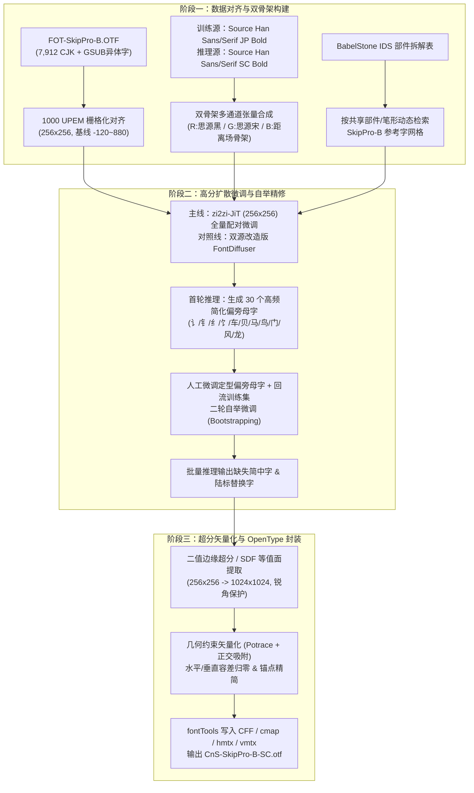

# CnS- 简中字符集扩充与风格迁移技术方案

> [!IMPORTANT]
> **核心目标**：以本仓库 [`FOT-SkipPro-B.OTF`](./FOT-SkipPro-B.OTF) 现有的 **7,912 个原版汉字**为唯一风格真值（Style Ground Truth），仅将**思源黑体 / 思源宋体**作为字形结构参考骨架（Content Skeleton），通过深度学习生成具有完全一致设计语言的简体中文缺失字符与陆标字形，最终矢量化并封装为生产可用的 OpenType 字体。

---

## 1. 基底字体（`FOT-SkipPro-B.OTF`）逆向解析

在选定生成模型前，对 [`FOT-SkipPro-B.OTF`](./FOT-SkipPro-B.OTF)（Fontworks Skip Pro B）的二进制表结构、字符覆盖率与造型特征进行定量拆解：

### 1.1 OpenType 度量与轮廓规格

| 属性项 | 实测参数 | 工程含义 |
| :--- | :--- | :--- |
| **轮廓格式** | `OTTO`（`CFF` 三次贝塞尔曲线） | 矢量化回写需转换为标准三次贝塞尔轮廓并做子程序压缩（`cffsubr`） |
| **字框精度（UPEM）** | `1000` | 标准日文/Adobe CJK 千分字框，生成字形需严格映射至 `1000×1000` 坐标系 |
| **垂直度量（Ascender / Descender）** | `880` / `-120` | 标准 CJK 字面基线区间 `[-120, 880]`，对齐思源黑/宋 `1000 UPEM` 坐标系无需非线性缩放 |
| **字重等级（`OS/2.usWeightClass`）** | `700`（Bold） | 骨架参考应配对选用 **Source Han Sans Bold** 与 **Source Han Serif Bold** |
| **字形总数 / Unicode 映射数** | `15,446` Glyphs / `10,012` 码位 | Adobe-Japan1 Pro 规格，内置 `trad`、`jp78`、`jp83`、`expt`、`vert` 等 26 项 `GSUB` 特性 |

### 1.2 简中字符集缺口统计

| 字符集范围 | 总字数 | 已覆盖 | 缺失数 | 覆盖率 | 典型缺失示例 |
| :--- | :---: | :---: | :---: | :---: | :--- |
| **CJK 统一表意文字（`U+4E00..U+9FFF`）** | 20,992 | 7,912 | 13,080 | 37.7% | — |
| **GB2312 一级常用字** | 3,755 | 2,501 | **1,254** | 66.6% | `专、业、丛、东、丝、两、严、临、为、丽、书、买` |
| **GB2312 全集（一+二级）** | 6,763 | 3,780 | **2,983** | 55.9% | 含大量现代汉语常用简化字与形声字 |
| **《通用规范汉字表》（国标 8,105 字）** | 8,105 | ~4,200 | **~3,900** | ~51.8% | 三级字表中的姓氏、地名、科技术语用字 |

> [!WARNING]
> **两大结构性难点**：
> 1. **简体专属偏旁零样本问题**：经查验，`讠(语)、钅(银)、纟(红)、饣(饭)、车、贝、见、页、马、鸟、风、韦、齿、龙` 等核心简化字及简化偏旁在原字库中 **完全不存在**（仅有繁体/日标新字体 `言、金、糸、食、車` 等）。因此**纯部件裁切拼字方案不可行**，模型必须学会**笔画级（Stroke-level）几何渲染规则**并泛化至新偏旁。
> 2. **中日同码异形（JP vs CN）问题**：已覆盖的 3,780 个 GB2312 共码汉字中，部分字遵循日本 JIS 字形标准（如 `骨、直、真、令、刃、海、社、神` 的局部笔势或点画数与陆标 `G` 源不同）。训练与推理必须严格区分 `JP` 与 `SC` 骨架。

### 1.3 视觉设计语言拆解

`FOT-Skip Pro B` 并非单一黑体或宋体，而是极具辨识度的**“几何黑体横竖 + 人文宋楷撇捺”混血设计**：
* **直线笔画（横、竖、折）**：等线平直，无明朝体横末的三角形“鳞（ウロコ）”，转折干净利落（接近**思源黑体**）；但起笔处带有轻微的微张斜切口，并非死板的纯矩形截断。
* **曲线笔画（撇、捺、点、钩）**：撇尖锋利舒展，捺画具显著粗细渐变与斜切顿足，点画呈饱满的水滴切角状，“风字钩/竖弯钩”具锐利上挑钩尖（笔势曲率接近**思源宋体**）。
* **对生成分辨率的硬约束**：轮廓边缘极度硬朗锐利，无手写飞白。若采用 `80×80` 或 `96×96` 低清栅格直接描边，微切角与锐利钩尖会被严重圆钝化，**工程管线有效栅格分辨率需达到 `256×256` 乃至 `512×512` 以上**。

---

## 2. 候选生成模型调研与优劣评估

结合本项目**“拥有 7,912 个同字体配对真值样本”**与**“混血锐利几何风格”**两大前提，对主流 Few-Shot Font Generation (FFG) 与字体合成方案进行横向评估：

### 2.1 模型矩阵总览

| 模型方案 | 出处 / 论文 | 核心架构 | 原生分辨率 | 核心优势 | 针对本项目的局限性 | 推荐度 |
| :--- | :--- | :--- | :---: | :--- | :--- | :---: |
| **[DG-Font](https://github.com/ecnuycxie/DG-Font)** | CVPR 2021 `arXiv:2104.03064` | GAN + 可变形卷积（FDSC） | `80×80` | 推理极快；可变形卷积对笔画空间位移有几何直觉 | 锁死 `80px` 超低清；单源字体输入无法兼顾黑体横竖与宋楷撇捺；复杂字易断笔粘连 | ⭐☆☆☆☆ |
| **[CF-Font](https://github.com/wangchi95/CF-Font)** | CVPR 2023 `arXiv:2303.14017` | GAN + 多基字融合（CFM）+ PCL | `80×80` *(字面50px)* | **多基字线性融合（CFM）**极契合“黑+宋”双参考骨架；投影损失稳重心 | 默认 `S80F50` 字面仅 `50×50` 像素，转曲后切角细节全毁；多步聚类脚本链路繁琐 | ⭐⭐☆☆☆ |
| **[FontDiffuser](https://github.com/yeungchenwa/fontdiffuser)** | AAAI 2024 `arXiv:2312.12142` | 条件像素扩散（DDPM）+ MCA + SCR | `96×96` | 无模式崩溃；多尺度内容聚合防漏笔能力强；有现成 HF 权重与微调脚本 | 原生 `96px` 偏低（需外挂超分或改架构）；默认单参考图推理易因局部缺笔画导致风格漂移 | ⭐⭐⭐⭐☆ |
| **[zi2zi-JiT](https://github.com/kaonashi-tyc/zi2zi-JiT)** | 2025/2026 开源工业向项目 | Pixel-Space Diffusion Transformer (`JiT`) | **`256×256`** | **专为生产级 CJK 补字设计**；原生 `256px` 高清；双参考网格上下文覆盖全笔形；开源 `B/L-16` 权重 | 像素空间 Transformer 训练与采样显存开销高于轻量 GAN | ⭐⭐⭐⭐⭐ |
| **[QT-Font](https://github.com/lsflyt-pku/QT-Font)** | SIGGRAPH 2024 | 四叉树稀疏扩散（Quadtree Diffusion） | **`256`~`512+`** | 利用字形稀疏性突破扩散显存墙，高分边缘极锐利 | 强依赖定制二维 `ocnn` 算子，环境编译与魔改门槛高 | ⭐⭐⭐⭐☆ |
| **[VQ-Font](https://github.com/Yaomingshuai/VQ-Font)** / **[MX-Font](https://github.com/clovaai/fewshot-font-generation)** | AAAI 2024 / ICCV 2021 | 局部专家头 / VQ 码本跨注意力 | `128×128` | 代码规范；无需人工标注即可提取部件/子字形级局部风格 | 面对原字库 0 覆盖的简化偏旁（`讠、钅、纟`），离散码本匹配易在笔画交接处产生伪影 | ⭐⭐⭐☆☆ |
| **[IF-Font](https://github.com/Stareven233/IF-Font)** / **[AGDFont](https://github.com/HAIV-Lab/AGDFont)** | NeurIPS 2024 / PRCV 2025 | IDS 拆字序列引导 / 多参考对比扩散 | `96`~`128` | 引入 IDS 树显著降低 15 画以上复杂字的错漏笔率；多参考均值融合稳方差 | 独体简化字（如 `专、书、买、龙`）无繁体同构部件可循，IDS 增益有限 | ⭐⭐⭐☆☆ |
| **[DeepVecFont-v2](https://github.com/yizhiwang96/deepvecfont-v2)** / **[VecFontSDF](https://github.com/xiazeqing/VecFontSDF)** | CVPR 2023 | 图像+矢量双模态 Transformer / 隐式 SDF | 矢量 / SDF | 原生输出贝塞尔曲线或解析距离场，理论上省去位图描边环节 | 多闭合回路复杂汉字控制点序列过长，极易出现路径自交、锚点冗余或横竖微歪（非严格 90°） | ⭐⭐☆☆☆ |

### 2.2 选型核心洞察

1. **充分利用 7,912 字存量优势（Supervised Fine-Tuning > Pure Zero-Shot）**：
   大多数 FFG 论文致力于在“未见过的字体上仅凭 8 个字 Zero-Shot 推理”，将风格压缩为低维向量，必然丢失 `Skip Pro B` 起笔微张切角等微妙特征。本项目拥有 **7,912 对精确配对字形**，必须在目标字体上做**单字体全量微调（Target-Font Fine-Tuning）**，让网络权重直接记住该字体的精确笔触几何。
2. **跨模型理念组合最优**：
   采用 **`zi2zi-JiT`（`256×256` 高分主干）**（或微调版 **`FontDiffuser`** 作为轻量对照），同时融入 **`CF-Font` 的多源骨架融合思想**（思源黑 + 思源宋双通道输入）与 **`IF-Font` 的 IDS 部件检索策略**（智能挑选参考字）。
3. **高分栅格 + 几何约束矢量化优于端到端直出 SVG**：
   在工业级中文字库补全中，先生成 `256×256` 栅格并经有符号距离场（SDF）/ 边缘超分至 `1024×1024`，再通过带正交吸附的 `potrace` 转曲，其结构稳定性与轮廓整洁度远高于直接回归贝塞尔坐标序列。

---

## 3. 核心工程架构设计

### 3.1 阶段一：数据准备与“训推字形标准解耦”

1. **训练用 `JP`、推理用 `SC`（杜绝异形骨架污染）**：
   * **训练阶段**：使用 `Source Han Sans JP Bold` 与 `Source Han Serif JP Bold` 渲染 `Skip Pro B` 已有的 7,912 个汉字（并解析 `GSUB` 中的 `trad` 特性提取额外繁体字形对）。两者同属 Adobe-Japan1 日标字形规范，笔画数、拓扑连接 100% 严丝合缝，使模型专注于学习**纯粹的笔形几何风格映射**。
   * **推理阶段**：将输入源切换为遵循中国大陆国标（GB 18030 / 通用规范汉字表）的 `Source Han Sans SC Bold` 与 `Source Han Serif SC Bold`。不仅能补齐缺失的 2,983+ 个简体字，还能顺带为需要陆标化的共码字生成标准陆标字形。
2. **双骨架三通道条件编码（Dual-Skeleton Conditioning）**：
   不再丢弃三通道输入中的冗余通道，而是将单张源字符图像构造为精确对齐的 `256×256×3` 张量：
   * **R 通道（思源黑体 Bold）**：提供平直等线的横竖折骨架、无鳞端头与 `700` 字重黑度基准。
   * **G 通道（思源宋体 Bold）**：提供撇、捺、点、钩的自然曲率走势、起收笔方向与捺脚舒展空间。
   * **B 通道（中轴距离变换场 Medial-Axis SDF）**：对思源黑体做形态学骨架提取与欧氏距离变换，显式编码笔画粗细中心线，防止密集多笔画字（如 `矗、囊、鬱`）糊连。
3. **基于 IDS 的结构感知参考字检索**：
   利用 [BabelStone IDS](https://www.babelstone.co.uk/CJK/IDS.html) 将每个汉字拆解为部件集合：
   * 若目标字含 `Skip Pro B` 已有部件（如生成 `语 = ⿰讠吾` 时，右部 `吾` 及含 `口/五` 的字已在库中），优先检索含相同部件及相近包围结构（如 `⿰` 左右结构）的原版字填入参考网格。
   * 若部件在原库缺失（如左部 `讠`），按笔画特征映射表检索含“点 + 横折提/竖钩”的原版字（如 `計、討、道、永`）提供笔触先验。

### 3.2 阶段二：模型训练与“简化偏旁自举（Bootstrapping）”策略

#### 主推路线 A：基于 `zi2zi-JiT` (`256×256`) 的上下文扩散微调
* **底座权重**：加载 `zi2zi-JiT-L-16.pth` 预训练权重，输入格式为 `1024×256` 拼接画布（`双骨架源图 | 目标真值图 | 2×2 部件相近参考网格 | 2×2 全局典型笔形网格`）。
* **数据增强（攻克零样本简化偏旁）**：在训练时对源骨架图像施加轻微的弹性网格微扰（小幅度仿射缩放）与随机局部部件遮挡，迫使注意力机制不仅做整字记忆，更能从参考网格中跨区域搬运“点、提、撇、钩”的局部几何法则。

#### 备选对照路线 B：基于 `FontDiffuser` 的双源融合微调
* 在 `FontDiffuser` 的内容编码器前端并联两路分支（分别提取思源黑与思源宋多尺度特征，经 `1×1` 卷积门控融合后送入 MCA 模块），并将单张风格参考扩展为 **8 张参考字特征均值池化（Multi-Reference Mean Pooling）**，消除单字采样偏差。

#### 关键提质技巧：两阶段偏旁自举（Radical Bootstrapping）
由于简体字中超 75% 为形声字，高频简化偏旁（`讠、钅、纟、饣、车、贝、见、页、马、鸟、门、风、韦、齿、龙、纟、艹、辶`）的造型直接决定整套字库的观感上限：
1. **第一轮微调后**：先行生成包含上述简化偏旁的 **30~50 个代表性母字**（如 `语、说、银、铁、红、织、饭、车、轮、贝、见、页、马、鸟、风、龙、东、书`）。
2. **人工矢量精修母字**：在 FontForge / Glyphs 中对这 30~50 个母字的简化偏旁做微调定型（校准切角、提笔角度与字重灰度），确保其达到 Fontworks 原厂水准。
3. **第二轮回流微调**：将这批精修母字加入训练集做短周期二轮微调，并在批量生成所有同偏旁形声字时，**强制将该偏旁的精修母字固定在参考网格首位**，从而保证全部数千个简体形声字的偏旁高度统一！

### 3.3 阶段三：高清锐化、几何约束矢量化与字体打包

1. **超分与锐角保护（`256×256 → 1024×1024`）**：
   * 训练一个超轻量的二值字形超分/SDF 回归小网络（直接在 `Skip Pro B` 自身的 `256px` 下采样图与 `1024px` 原生光栅图配对训练！零外部域偏差！），专门把 `256×256` 扩散输出无损锐化还原为 `1024×1024` 剃刀级清晰边缘，完美复原起笔喇叭微切角与锐利钩尖。
2. **几何约束矢量化（Vectorization & Orthogonal Snapping）**：
   * 使用 `potrace` 提取三次贝塞尔轮廓，调优转角阈值参数（`--alphamax 0.85` 防止锐利切角被过度平滑为圆弧，`--turdsize 10` 滤除孤立噪点）。
   * **正交切线吸附后处理**：编写 Python 几何规整脚本，检测所有接近水平（`0° ± 1.8°`）或垂直（`90° ± 1.8°`）的直线段（对应 `Skip Pro B` 的黑体横竖干），将其首尾锚点坐标强制对齐至同一 `x` 或 `y` 整数值，消除位图描边常见的“横画微斜/边缘波浪纹”。
3. **OpenType 合并与双模式封装**：
   * 使用 `fontTools` + `cffsubr` 读取原 [`FOT-SkipPro-B.OTF`](./FOT-SkipPro-B.OTF)，保持原字体所有西文、假名、标点、`GPOS/GSUB` 及垂直排版表（`vhea/vmtx/VORG`）完整无损：
     * **新增缺字**（如 GB2312 缺失的 2,983 字及通用规范汉字表缺字）：新增 CID/Glyph 记录，写入 `CFF`、`hmtx`（`advanceWidth = 1000`）、`vmtx` 与 `cmap`。
     * **中日同码异形字**：提供两种构建产物——
       1. `CnS-SkipPro-B-SC.otf`：默认 `cmap` 直接指向陆标简中字形，开箱即用于简中游戏/UI/排版环境；
       2. `CnS-SkipPro-B-Std.otf`：保留原日标默认字形，通过 OpenType `locl`（`hani` script, `ZHS` language）特性挂载陆标异形字，实现中日混排标准切换。

---

## 4. 自动质检指标与实施路线图

### 4.1 自动化质检流水线（QA Pipeline）

批量生成的数千字通过四道自动关卡筛查异常字（仅将得分垫底的 ~5% 交由人工复核）：
1. **OCR 结构正确性校验**：使用离线中文 OCR（如 PaddleOCR / PP-OCRv4）识别生成字图像，若 Top-1 识别结果与目标字符不一致，自动标记为“疑似错笔/漏笔/粘连”触发重采样（更换随机种子与参考字）。
2. **字重灰度一致性（ Ink Density Check ）**：对比生成字与思源黑体参考字的黑像素面积比（预测应落在局部邻域回归区间 `±8%` 内），拦截笔画过粗糊死或过细断线的异常样本。
3. **视觉相似度指标**：在留出验证集（从 7,912 原字中分层抽样 400 字不参与训练）上监控 `L1 ↓`、`SSIM ↑`、`LPIPS ↓` 与边缘 `Chamfer Distance ↓`。
4. **矢量拓扑健康度**：统计单个字形的 `CFF` 锚点总数与闭合轮廓数，拦截锚点异常暴增（`> 250` 点）或存在自交回路的字形。

### 4.2 分期实施里程碑（Milestones）

| 阶段 | 任务目标 | 核心交付物 |
| :---: | :--- | :--- |
| **M1：数据与管线基建** | 完成 `FOT-SkipPro-B` 全量导出、思源黑/宋 `JP`/`SC` 双骨架渲染、IDS 参考字检索器及「`256→1024` 字体专属超分+Potrace 正交转曲」闭环验证（先拿原字下采样再还原做无损测试） | `scripts/prepare_dataset.py` `scripts/vectorize_pack.py` |
| **M2：模型微调与消融对比** | 在 7,512 训练字 / 400 验证字上微调 `zi2zi-JiT`（及对照模型 `FontDiffuser`），对比单骨架 vs 黑宋双骨架的边缘精度与笔势还原度 | 微调权重 Checkpoints & 验证集视觉对比图 |
| **M3：简化偏旁自举与首期补字** | 生成并精修 40 个高频简化偏旁母字，完成二轮自举微调；全量生成 **GB2312 缺失的 2,983 字**（优先保障一级字表 1,254 字 100% 过检） | GB2312 完整覆盖测试版 `.otf` |
| **M4：通规 8,105 字与陆标化收官** | 扩充补齐《通用规范汉字表》全部 8,105 字，处理常用中日异形字替换，执行 `cffsubr` 轮廓子程序压缩与排版实测 | 正式发布版 `CnS-SkipPro-B-SC.otf` |

---

## 5. 参考文献与开源仓库索引

1. **DG-Font**: Yangchen Xie et al., *"DG-Font: Deformable Generative Networks for Unsupervised Font Generation"*, CVPR 2021 (`arXiv:2104.03064`) — [ecnuycxie/DG-Font](https://github.com/ecnuycxie/DG-Font)
2. **CF-Font**: Chi Wang et al., *"CF-Font: Content Fusion for Few-Shot Font Generation"*, CVPR 2023 (`arXiv:2303.14017`) — [wangchi95/CF-Font](https://github.com/wangchi95/CF-Font)
3. **FontDiffuser**: Zhenhua Yang et al., *"FontDiffuser: One-Shot Font Generation via Denoising Diffusion with Multi-Scale Content Aggregation and Style Contrastive Learning"*, AAAI 2024 (`arXiv:2312.12142`) — [yeungchenwa/FontDiffuser](https://github.com/yeungchenwa/FontDiffuser)
4. **zi2zi-JiT**: *"Font Synthesis with Pixel-Space Diffusion Transformer"* — [kaonashi-tyc/zi2zi-JiT](https://github.com/kaonashi-tyc/zi2zi-JiT)
5. **QT-Font**: Yitian Liu & Zhouhui Lian, *"QT-Font: High-efficiency Font Synthesis via Quadtree-based Diffusion Models"*, SIGGRAPH 2024 — [lsflyt-pku/QT-Font](https://github.com/lsflyt-pku/QT-Font)
6. **VQ-Font / MX-Font**: [Yaomingshuai/VQ-Font](https://github.com/Yaomingshuai/VQ-Font) (AAAI 2024) / [clovaai/fewshot-font-generation](https://github.com/clovaai/fewshot-font-generation) (ICCV 2021, `arXiv:2104.00887`)
7. **IF-Font / AGDFont**: [Stareven233/IF-Font](https://github.com/Stareven233/IF-Font) (NeurIPS 2024) / [HAIV-Lab/AGDFont](https://github.com/HAIV-Lab/AGDFont) (PRCV 2025)
8. **DeepVecFont-v2 / VecFontSDF**: [yizhiwang96/deepvecfont-v2](https://github.com/yizhiwang96/deepvecfont-v2) (`arXiv:2303.14785`) / [xiazeqing/VecFontSDF](https://github.com/xiazeqing/VecFontSDF) (`arXiv:2303.12442`)
