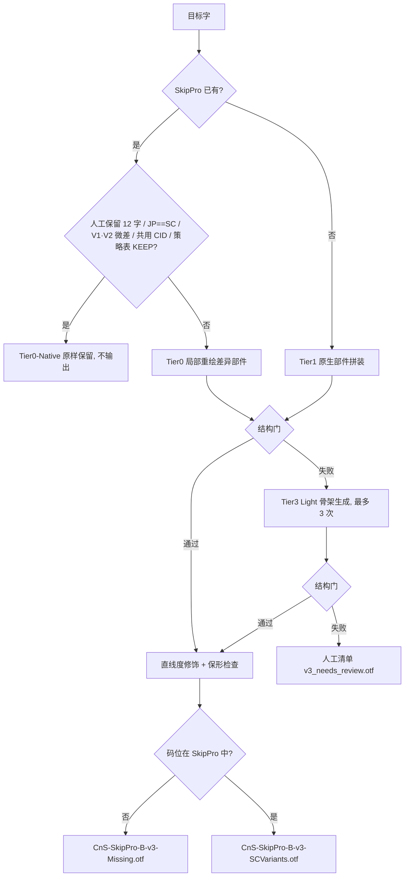

# CnS Plan 3.0：去骨架化输入 · 结构优先的验收门 · 中日微差保留策略

> 本方案针对 v2.0（提交 `38d374f`）发现的三个问题：
> 1. 参考骨架（思源）的设计风格渗入过深；
> 2. 异形偏旁/组件重绘时，“直线”被过度奖励，形成奖励作弊，骨架约束实际上没有生效；
> 3. 仅有「竖弯钩 ↔ 竖 + 提」或 `ネ ↔ 礻` 这类微小差异的字被不必要地重新生成。
>
> 第 0 节给出对 v2.0 代码与产物的实测审计数据，第 1–3 节逐一给出修正设计，第 4 节是输出拆分，第 5 节是里程碑与验收标准。

---

## 0. 审计结论（v2.0 实测数据）

审计环境：本地 `FOT-SkipPro-B.OTF`、`NotoSerifCJK-VF.ttc` / `NotoSansCJK-VF.ttc`（`uharfbuzz` 按 `ja` / `zh-Hans` 取形），以及 v2.0 的 `src/v2/*`。

### 0.1 问题 1：骨架风格渗入的根源

| 审计项 | v2.0 现状 | 结论 |
| :--- | :--- | :--- |
| 生成器输入通道（`cmds_to_dual_sdf_input`） | `[0]` Serif `wght=700` SDF、`[1]` Sans `wght=620` SDF、`[2]` **(Serif − Sans) 差分图**、`[3]` 笔画深度 | 第 `[2]` 通道本身就是思源宋体的三角饰脚和笔锋特征，等于把思源的设计风格直接作为条件喂给模型 |
| 平均笔画宽度（UPEM，骨架长度法） | SkipPro-B：`69–100`；Sans 620：`84–126`；Serif 700：`51–77`；**Sans 300（Light）：`44–53`** | Sans 620 比目标字体还粗，模型和 QA 都在拿“比目标更重”的思源当参照 |
| Tier 1 部件框（`estimate_target_slot_bboxes`） | 取自 Sans 620 的连通岛屿 | 部件位置、比例连同思源的字重一起被继承 |
| QA 参照（`check_glyph_qa_v2`） | 与 Sans 620 做整字墨迹 IoU | 输出越接近思源的粗细越容易通过，鼓励风格趋同 |
| 路由占比（`v2_tg8105_metrics.json`） | 6,323 个目标字中 **Tier 3 整字 SDF 生成占 4,745 个（75%）**，只有 287 个走 Tier 0 局部手术 | 受骨架影响最深的路径成了主路径 |
| SkipPro 已有字被整字重建 | `diff_replace` 有 2,205 个，Tier 0 只处理了 287 个 | **约 1,900 个 SkipPro 原有字被整字重建**，原厂轮廓全部丢弃 |

### 0.2 问题 2：奖励作弊的证据

**(a) 验收门分辨不出错字。** 用 v2.0 的 `check_glyph_qa_v2` 对 300 个 `diff_replace` 字做反例测试：

| 送检字形（应当全部被拒） | 通过率 |
| :--- | :---: |
| 未修改的日标 SkipPro 原字（直接把日本字形当作陆标交付） | **92.0%** |
| 随机抽取的另一个不相关的 SkipPro 字 | **12.3%** |

具体错字对照（目标字 ← 实际送检的字）：

| 目标 | 送检 | 是否通过 | IoU |
| :---: | :---: | :---: | :---: |
| 直 | 真 | ✅ 通过 | 0.550 |
| 微 | 徽 | ✅ 通过 | 0.671 |
| 红 | 紅（繁体） | ✅ 通过 | 0.564 |
| 饭 | 飯（繁体） | ✅ 通过 | 0.562 |

原因：门槛是整字栅格 `IoU ≥ 0.45` 加上包围盒差 `< 240u`。异形部件通常只占整字墨迹的 5–20%，部件画错对整字 IoU 几乎没有影响。

**(b) 验收门同时会误杀原字。** 在 JP==SC 的原厂字上标定，`calib_false_alarm_rate = 17%`。也就是说这个门既放过错字，又拒掉正确的字，没有区分能力。

**(c) 直线奖励是靠后处理凑出来的。**
- 训练里的 `HessianStraightnessLoss` 只作用在 **5.8%** 的像素上（`stem_band`），16 个 epoch 的值一直是 `hess=0.0019`，模型实际上没有从这一项学到东西。
- 直线完全来自 `optimize_synthesized_contours` 的强制吸附：`±3.2°`、`max_perp ≤ 8u` 内一律变直线，12° 以内的拐点直接合并。
- 验收指标 `mid_stem_nodes == 0` 正是这一步保证的，指标在构造上必然达标，测不出任何东西。
- 吸附之后**没有**检查形状偏离（没有 Hausdorff 或面积约束），所以弧形笔画（竖弯钩、撇、捺）可能被拉直，指标反而更好看。

**(d) 不合格的字照样打包。** `v2_build_tg8105.py` 对 Tier 3 结果即使 `ok3 == False` 也会写入字库，21 个 QA 异常只记录、不拦截。

**(e) 部件替换没有逐部件验收。** Tier 0 Rule B 换上的部件不与陆标参照的对应部件区域比对；捐赠部件的校验只是 56px 下 `IoU ≥ 0.48`。

### 0.3 问题 3：不必要的重新生成

| 审计项 | 结果 |
| :--- | :--- |
| 116 个 Master Bank 母件中 SkipPro-B 已有的 | **35 个**，v2.0 全部用 Tier 3 重新生成 |
| 其中 GID 完全相同（JP==SC） | `忄 艹 冫 阝 夹 丰 半 平 羽` |
| 部首区与汉字区共用同一字形 | `礻 U+793B` = `⺭ U+2EAD` = `cid14905`；`衤 U+8864` = `⻂ U+2EC2` = `cid15114`；`辶`、`亠`、`忄`、`冫`、`阝`、`艹` 也都有原生字形 |
| 原因 | Master Bank 第 1 轮只在 `ch ∈ jp_diff_set` 时才尝试保留原字，而 `jp_diff_set` 只覆盖通规 8,105 字，部首和不在表内的字直接进入生成流程 |
| 因 `衣 / 衤 / 示 / 礻` 标记被强制替换的字 | **91 个**（礼衣初社祀依宗衫祈祖神祝祠袖袍被祥袋祭裕裙福裳…） |
| 日中整字 IoU ≥ 0.90、只因命中 `MAINLAND_VARIANT_MARKERS` 被替换的字 | **128 个**（扑并折抓芹芥汰拆抱拙苑泡注…） |
| 独立部首日中 IoU 失真 | `亠 = 0.12`、`礻 = 0.27`：思源日中版本把部首放在字身框里的位置不同，未做包围盒对齐就比较，差异被严重高估 |

> 注：截图中的码位是 `U+2EAD`（⺭ CJK RADICAL SIMPLIFIED SPIRIT TWO）。`U+2EA0` 是 `⺠`（民），在 SkipPro-B 中是另一个字形 `cid03773`。

---

## 1. 去骨架化输入（问题 1）

### 1.1 原则

参照 zi2zi 的做法：参考字体只提供**拓扑和位置**（有哪些笔画、笔画在哪、怎么相交）；**粗细、横竖对比、起收笔、弧度**全部从 SkipPro-B 学习。参考字体越“中性”，可迁移的风格信息就越少。

### 1.2 新输入方案

| 通道 | v2.0 | v3.0 |
| :---: | :--- | :--- |
| 0 | Serif 700 SDF | **Sans Light（`wght=300`）SDF** |
| 1 | Sans 620 SDF | **等宽骨架 SDF**：对 Sans Light 做中轴细化，再按固定 `40u` 半宽重新渲染，彻底去掉思源的收笔、粗细变化和字重 |
| 2 | (Serif − Sans) 差分 | **笔画方向场 `cos2θ`**（结构张量方向，让模型能学到 SkipPro 横细竖粗的对比） |
| 3 | 笔画深度 | **笔画方向场 `sin2θ`** |

- **完全移除思源宋体**（包括差分通道），宋体的饰脚和笔锋不再进入任何环节。
- **字重抖动增强**：训练时参考字重在 `wght ∈ [250, 400]` 内随机取值，等宽骨架半宽在 `[32u, 48u]` 内随机取值，防止模型依赖某个固定笔宽（与 zi2zi 使用中性源字体的思路一致）。
- 推理固定使用 `wght=300` 和 `40u` 半宽。
- 需要重新训练（`checkpoints/v3_zh_sdf_light.pt`）。训练对仍为“日标 Light 输入 → SkipPro-B 原字”，留出集不变。

### 1.3 下游同步改动

- **Tier 1 部件框**：改为从 Sans Light 骨架计算，再按 SkipPro-B 实测半宽外扩（横向笔画 / 纵向笔画分别统计中位数），不再继承思源的粗细。
- **独立部首对比**：所有日中对比、IoU 和骨架差异计算前，先做**包围盒对齐**（平移 + 等比缩放），消除 `亠 / 礻` 这类放置位置造成的假差异。
- **风格渗入指标**（新增，用于评估）：在 JP==SC 留出集上计算
  `Leak = IoU(pred, Noto Sans 620) / IoU(pred, SkipPro 真值)`。
  v3 要求 `Leak` 比 v2 低至少 15%，同时对 SkipPro 真值的骨架 Chamfer 距离不变差。

### 1.4 消融实验（M2 中执行，选定最终输入组合）

| 组 | 输入 |
| :---: | :--- |
| A | v2 原配置（Serif 700 + Sans 620 + 差分 + 深度） |
| B | 仅 Sans Light |
| C | Sans Light + 等宽骨架 |
| D | Sans Light + 等宽骨架 + 方向场 + 字重抖动（推荐） |

评估指标：留出集 `Leak`、对 SkipPro 真值的骨架 Chamfer 距离、横/竖笔宽比与 SkipPro 的偏差、Hausdorff 距离。

---

## 2. 结构优先的验收门（问题 2）

核心变化：**先判断“结构对不对”，再判断“线条干不干净”**。直线度从“奖励”降级为“受约束的修饰”，不能再弥补结构错误。

### 2.1 结构门（必须先通过）

所有比较都在**包围盒对齐 + 等宽骨架化**之后进行，以消除字重和放置位置的影响。

1. **差异区方向判别（防作弊的核心）**
   - 对每个字取陆标参照骨架 `S_sc` 和日标参照骨架 `S_jp`（均为 Sans Light）：
     - `D_sc` = `S_sc` 中距离 `S_jp` 超过 `τ = 20u` 的部分（陆标独有笔画）；
     - `D_jp` = `S_jp` 中距离 `S_sc` 超过 `τ` 的部分（日标独有笔画）。
   - 候选字形的骨架必须满足：
     - 对 `D_sc` 的覆盖率 **≥ 80%**；
     - 对 `D_jp` 的残留率 **≤ 20%**；
     - 在差异区内，候选到陆标参照的 Chamfer 距离比到日标参照的小，且差值不低于设定的余量 `m`。
   - 作用：日标原字在构造上必然失败（直接堵住 92% 的漏洞）；`真 → 直`、`徽 → 微`、`紅 → 红` 这类替换会因为差异区不匹配或多出笔画而失败。整字 IoU 不再参与通过判定。
2. **逐部件验收**：按 IDS 把字拆成部件，每个**被替换的部件**单独与陆标参照的对应区域比对：骨架 Chamfer 均值 `≤ 12u`、95 分位 `≤ 30u`。
3. **拓扑一致**：孔洞数（欧拉数）与参照完全一致；骨架端点数、交叉点数与参照相差 ≤ 1（复杂字放宽到 ±15%）。
4. **整字骨架距离**：与陆标参照的骨架 Chamfer 均值 `≤ 15u`（替代 v2 的整字 IoU ≥ 0.45）。

### 2.2 直线度：受约束的修饰，不再是奖励

- **只吸附参照里本来就是直线的笔段**：在 Sans Light 骨架上做分段曲率分析，只有曲率接近 0 的横、竖、斜直笔段才允许拉直或做内凹腰线；竖弯钩、弯钩、撇、捺、点等**弧形笔段一律不吸附**。
- **保形检查**：吸附前后轮廓的 Hausdorff 距离 `≤ 4u`、面积变化 `≤ 1.5%`，超出则该段回退为原拟合曲线。
- **去掉吸附中的累积合并**：拐点合并阈值从 12° 收紧到 6°，并要求合并后的段在参照骨架上也是同一笔。
- **`mid_stem_nodes` 不再参与通过判定**，只作为“可吸附笔段”上的统计指标。

### 2.3 训练损失调整

| 项 | v2.0 | v3.0 |
| :--- | :--- | :--- |
| 直线项 | Hessian 损失，作用于 5.8% 像素，值恒为 0.0019 | **按笔段面积归一化**的法向一致性损失，直线笔段标签来自 **SkipPro 真值**，不再来自思源 |
| 结构项 | 无 | **clDice（软骨架拓扑损失）**，约束预测与真值的骨架拓扑一致 |
| 监控 | 无 | 每个 epoch 记录各项损失；若某项连续 3 个 epoch 变化 < 1%，判定为“失效项”并报警 |

### 2.4 不合格即拦截

- 任何一层未通过结构门 → **不写入成品字库**。依次改走：更换捐赠部件 → 局部重绘 → 换随机种子重新生成（最多 3 次）。
- 仍然失败的字写入 `manual_review/v3_needs_review.otf` 和对应清单，**交给人工处理**；成品字库中的这些码位保留原 SkipPro 字形或标为缺字，并在报告里如实计为失败。

### 2.5 局部重绘替代整字重建

对 SkipPro-B 已有的字（约 1,900 个曾被整字重建）：
- **必须先走 Tier 0**：保留所有未变部件的原厂轮廓，只重绘差异区（`D_sc ∪ D_jp`）所在的部件。
- 重绘使用**带掩码的局部 SDF 生成**：掩码外直接使用原厂距离场，掩码内由模型生成，边界做平滑衔接。
- 只有差异区超过整字骨架长度 50% 时，才允许整字生成。

### 2.6 验收门自身的回归测试

新增 `scripts/v3_gate_regression.py`，每次修改验收门都必须运行：

| 测试集 | 要求 |
| :--- | :--- |
| 正例：JP==SC 的原厂 SkipPro 字（≥ 1,000 个） | 通过率 **≥ 97%**（v2 为 83%） |
| 反例 1：日标原字冒充陆标 | 通过率 **≤ 1%**（v2 为 92%） |
| 反例 2：形近字替换（真/直、徽/微、今/令、信/言…） | 通过率 **≤ 1%** |
| 反例 3：繁体冒充简体（紅/红、飯/饭、語/语…） | 通过率 **≤ 1%** |
| 反例 4：随机不相关字 | 通过率 **0%**（v2 为 12.3%） |

---

## 3. 中日微差保留策略（问题 3）

### 3.1 新规则：可接受的微差类别

| 类别 | 描述 | 典型字 |
| :--- | :--- | :--- |
| V1 | 「竖弯钩 ↔ 竖 + 提」（`衣` 下部 `𧘇` 一类） | 衣、衤、依、表、初、被、裕、袋、裳… |
| V2 | `ネ ↔ 礻` 共用字形（部首区与汉字区共用同一个 CID） | 礻 `U+793B` / ⺭ `U+2EAD`、礼、社、神、祖、福… |

满足以下**全部条件**时，判定为 `KEEP_ORIGINAL`，直接保留 SkipPro-B 原字，不重新生成：
1. 包围盒对齐后，日中差异区（`D_sc ∪ D_jp`）**全部**落在 V1/V2 白名单部件的区域内；
2. 每个部件内的差异是**单一连通块**，长度 ≤ 该部件骨架总长的 18%；
3. 白名单部件之外**没有**任何差异。

任一条件不满足（例如同时有 `言` 字旁这类真正的陆标差异）→ 照常替换，但**只替换非白名单的差异部件**。

### 3.2 原生字形优先（Tier 0-Native，新增最高优先级）

- 任何字（包括母件和部首），只要 SkipPro-B 已有字形，并且满足 JP==SC（GID 相同）、或属于 V1/V2 微差、或部首区与汉字区共用同一 CID，就**原样使用**，不进入生成流程。
- Master Bank 中这 35 个原生字（`忄 艹 冫 阝 礻 衤 辶 亠 夹 丰 半 平 羽 衣`…）改为 `Tier0_Native`；其中真正有陆标差异的（如 `言 / 直 / 令`）仍按 2.5 节做局部重绘。

### 3.3 标记表降级为“候选提名”

- `MAINLAND_VARIANT_MARKERS` 命中只表示“这个字可能有差异，需要检查”，**不再直接决定替换**。
- 是否替换由第 2.1 节的包围盒对齐骨架差异来决定。预计可释放 v2 中 128 个“IoU ≥ 0.90 仅因标记被替换”的字，以及 91 个 `衣 / 衤 / 示 / 礻` 类字中满足 V1/V2 的部分。

### 3.4 人工可控

- 新增 `data_v3/variant_policy.tsv`：每行一个字，填 `KEEP` / `REPLACE` / `AUTO`，人工设置优先于自动判定。
- 构建前先输出 `manual_review/v3_keep_vs_replace.png`：按类别（V1 / V2 / 标记释放 / 真实差异）并排展示「原字 | 日标参照 | 陆标参照」，确认后再进入全量构建。

### 3.5 人工研判保留清单（硬性规则）

以下 12 个字在 SkipPro-B 中已有字形，经人工研判**不需要重新生成**：

| 码位 | 字 | 码位 | 字 | 码位 | 字 |
| :---: | :---: | :---: | :---: | :---: | :---: |
| `U+4E10` | 丐 | `U+534A` | 半 | `U+795E` | 神 |
| `U+4E30` | 丰 | `U+6BCF` | 每 | `U+8279` | 艹 |
| `U+514D` | 免 | `U+793B` | 礻 | `U+8863` | 衣 |
| `U+51AB` | 冫 | `U+793E` | 社 | `U+8864` | 衤 |

执行方式：
1. 写入 `data_v3/variant_policy.tsv`，策略为 `KEEP`，优先级高于所有自动判定（包括第 2.1 节结构门和 `MAINLAND_VARIANT_MARKERS`）。
2. **从调整后的 `CnS-Manual-Master-Bank.otf` 中移除**这 12 个字，母件字库由 116 字减为 104 字，`MANUAL_EDIT_GUIDE.md`、`master_bank_wireframe.png` 和 `master_bank_hashes.json` 同步更新。
3. 这 12 个字一律走 `Tier0_Native`，**不出现在第 4 节的任何输出字体中**。
4. 作为部件时同样使用原厂字形：下游拼装需要 `礻 / 衤 / 冫 / 艹 / 每 / 免 / 半 / 丰` 等部件时，从 SkipPro-B 原字中提取，不再使用生成的母件（例如 `海` 的 `每`、`被` 的 `衤`、`祖` 的 `礻`）。
5. 构建时校验：这 12 个码位在最终产物中的轮廓必须与 SkipPro-B 原字逐点一致，否则构建失败。

---

## 4. 输出拆分：两个独立字体文件

v2.0 把所有新字形合并进一个完整字体（`CnS-SkipPro-B-TG8105-SC.otf`）。v3.0 改为把**新增的字形**按来源拆成两个互不重叠的独立字体文件：

| 文件 | 内容 | 预计规模 |
| :--- | :--- | :--- |
| `outputs/CnS-SkipPro-B-v3-Missing.otf` | **原字体未覆盖的字符**：SkipPro-B 中没有的码位所生成的字形（通规 8,105 字中缺失的部分，以及母件字库里原字体没有的增补字，如 `讠 钅 纟 饣 丌`） | 约 4,101 个通规字 + 少量增补字 |
| `outputs/CnS-SkipPro-B-v3-SCVariants.otf` | **日标与国标字形不同而重新生成的字形**：SkipPro-B 中已有、但日中字形存在实质差异，且不属于忽略要求的字 | v2 为 2,205 个；扣除忽略项后预计明显减少，以 M1 人工确认结果为准 |

### 4.1 划分规则

- **忽略要求**指以下任一项：第 3.5 节人工保留清单（12 字）、`variant_policy.tsv` 中标为 `KEEP` 的字、V1/V2 微差类别、JP==SC、部首区与汉字区共用 CID。命中忽略要求的字**不进入任何输出文件**，使用原厂字形。
- 一个码位**只能出现在一个文件中**：
  - 码位不在 SkipPro-B 中 → `Missing`
  - 码位在 SkipPro-B 中，且需要陆标化重绘 → `SCVariants`
  - 其余 → 不输出（保留原厂字形）
- 构建时断言：`Missing ∩ SCVariants = ∅`；`Missing ∪ SCVariants ∪ 原厂保留` 覆盖全部通规 8,105 字。

### 4.2 字体文件规格

- 两个文件都是独立可安装的 OpenType CFF 字体，只包含 `.notdef` 和各自的字形（打包方式与 `build_subset_master_otf` 相同），并经 `cffsubr` 压缩。
- 度量与原字体一致：`UPEM = 1000`、`ascender = 880`、`descender = -120`、横排 / 直排步进 `1000`，沿用原字体汉字 FD 的 Private 字典。
- 两个文件使用**不同的字体家族名**（如 `CnS SkipPro B Missing`、`CnS SkipPro B SC Variants`），避免与原字体或彼此安装冲突。
- 每个文件附带清单 `outputs/v3_glyph_manifest.json`，逐字记录：码位、所属文件、生成路径（Tier0 局部重绘 / Tier1 / Tier3）、结构门结果、是否被人工改过。

### 4.3 合并字体（可选）

- 保留一个可选的合并步骤 `scripts/v3_merge_fonts.py`：把 SkipPro-B 原字体与上述两个文件合并为一个完整字体，用于预览样张和日常使用。
- 合并时 `SCVariants` 中的字形覆盖原字体对应码位；合并结果再次校验第 3.5 节 12 字与原厂逐点一致。
- 默认构建只输出两个独立文件，合并字体需显式加 `--emit_merged`。

---

## 5. 里程碑与验收标准

| 里程碑 | 内容 | 验收标准 |
| :--- | :--- | :--- |
| **M0** 验收门与测试 | 实现第 2.1 节结构门、第 2.6 节回归测试；包围盒对齐与等宽骨架工具函数 | 正例通过率 ≥ 97%；四类反例均满足表中上限 |
| **M1** 微差保留 | 实现 V1/V2 规则、Tier0-Native、标记降级、`variant_policy.tsv`（预置第 3.5 节 12 字 `KEEP`）；母件字库减为 104 字；输出 `v3_keep_vs_replace.png` 给人工确认 | 12 字不在母件字库中，且与原厂逐点一致；`礻 / 衤 / 衣 / 忄 / 冫 / 阝 / 艹` 等全部走 `Tier0_Native`；通规 8,105 字分类结果（Missing / SCVariants / 保留）经人工确认 |
| **M2** 去骨架化训练 | 新输入通道、字重抖动、新损失（归一化直线项 + clDice）；跑完 A/B/C/D 四组消融 | `Leak` 比 v2 低 ≥ 15%；各损失项无“失效项”报警；留出集骨架 Chamfer 不变差 |
| **M3** 修饰约束与局部重绘 | 第 2.2 节直线度约束、保形检查；第 2.5 节掩码局部重绘 | 吸附后 Hausdorff ≤ 4u；SkipPro 已有字的 Tier 0 占比从 287 个提升到其应有比例（目标 ≥ 80%） |
| **M4** 重建与基准 | 重建 104 字 Master Bank、M2 基准（新增反例测试）、通规 8,105 全量构建；按第 4 节输出 `Missing` 与 `SCVariants` 两个独立字体及清单 | 两个文件码位无重叠，与原厂保留部分合计覆盖 `8,105 / 8,105`；12 字不出现在任何输出文件中；结构门通过率 ≥ 98%，未通过的字全部进入人工清单而非成品；`v2` 与 `v3` 并排对比样张 |

### 5.1 需要改动的文件

| 文件 | 改动 |
| :--- | :--- |
| `src/v2/hb_outlines.py` → `src/v3/` | Sans Light 取形、包围盒对齐、等宽骨架渲染、方向场 |
| `src/v2/zh_sdf_fallback.py` | 新输入通道、字重抖动、归一化直线损失、clDice、损失监控、掩码局部重绘 |
| `src/v2/stats_and_qa.py` | 替换为结构门（差异区方向判别、逐部件、拓扑、骨架距离） |
| `src/v2/curve_optimizer.py` | 只吸附参照直线笔段、保形检查、收紧拐点合并 |
| `src/v2/component_bank.py` | Tier0-Native、V1/V2 规则、部件框改用 Light 骨架加半宽外扩、逐部件验收 |
| `scripts/v2_build_*.py` → `scripts/v3_*.py` | 新路由顺序：Tier0-Native → Tier0 局部重绘 → Tier1 → Tier3；不合格拦截 |
| 新增 `scripts/v3_gate_regression.py`、`data_v3/variant_policy.tsv` | 回归测试与人工策略表（预置第 3.5 节 12 字） |
| `src/v2/stroke_assembler.py` | 新增按码位集合输出独立字体的打包函数（家族名可配置），替代合并式 `pack_v2_tg8105_otf` |
| 新增 `scripts/v3_merge_fonts.py` | 可选：原字体 + 两个输出文件合并为完整字体 |

### 5.2 新路由顺序

