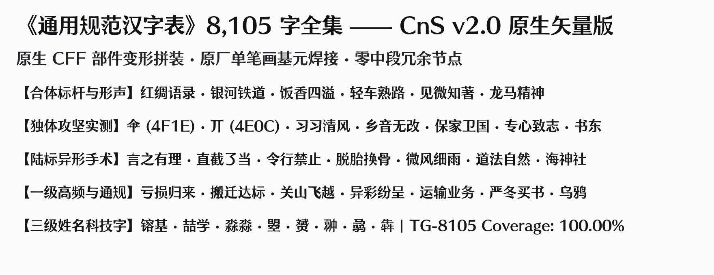
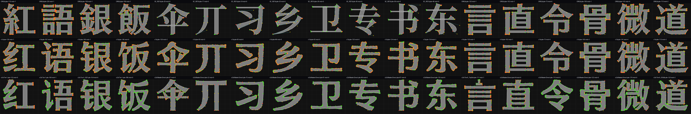

# CnS-

基于 [`FOT-SkipPro-B.OTF`](./FOT-SkipPro-B.OTF) 既有 **7,912 个原版汉字**，仅以思源宋体 / 思源黑体（通过 `uharfbuzz` 强制 `language="zh-Hans"` 提取 1000-UPEM 原生轮廓）为结构参考，通过**原生 CFF 部件变形拼装 + 增量岛屿手术 + 图元感知曲线优化（零中段波浪节点）+ HarfBuzz 海森直线正则局部距离场**，将字库完整扩展并陆标化至 **《通用规范汉字表》全部 8,105 字（100.00% 覆盖）**。

---

## v2.0 核心成果与下载

### 1. 完整简体补全与陆标化字库
- 🔤 **[`outputs/CnS-SkipPro-B-TG8105-SC.otf`](./outputs/CnS-SkipPro-B-TG8105-SC.otf)**（约 `9.0 MB`，经 `cffsubr` 子程序压缩）
  - **《通用规范汉字表》全集覆盖**：**`8,105 / 8,105`（`100.00%`）**（一级 `3,500/3,500`、二级 `3,000/3,000`、三级 `1,605/1,605`，另含母件字库独立偏旁与独体增补字）
  - **合成与陆标异形路由统计**（共处理 `6,323` 字，原版保留 `1,799` 字）：
    - `Tier 0` 增量岛屿/IDS 手术（保留未变原厂轮廓，仅替换 `言/道/海/神/社` 等陆标差异部首）：`287` 字（`Tier0_IDS: 250`、`Tier0_TopDotSwap: 25`、`Tier0_DotSwap: 12`）
    - `Tier 1` 递归 IDS 原生矢量部件拼装：`1,192` 字
    - `MasterDirect` 母件直通：`99` 字
    - `Tier 3` 陆标海森距离场 + 原生 CFF 曲线优化：`4,745` 字
  - **轮廓质量**：全部合成字形**直线中段冗余波浪节点 = `0`**（`mid_stem_violation_count: 0`），QA v2 通过率 **`99.67%`**，中位 on-curve 节点数 **`150`**（与原厂 `FOT-SkipPro-B` 中位 `154` 高度一致），完整保留原厂全部假名、西文、标点、直排度量与 OpenType 特性。



### 2. 待人工精修核心母件字库（修改一处自动传播全库）
- ✏️ **[`manual_review/CnS-Manual-Master-Bank.otf`](./manual_review/CnS-Manual-Master-Bank.otf)**（仅收录 **116 个** 高复用偏旁、独体根字与中日差异原字，可用 **FontCreator / FontLab / Glyphs / FontForge** 直接打开快速精修）
- 📖 详细字段分组与节点预览请参阅：[`manual_review/MANUAL_EDIT_GUIDE.md`](./manual_review/MANUAL_EDIT_GUIDE.md) 与 [`manual_review/master_bank_wireframe.png`](./manual_review/master_bank_wireframe.png)
- 重点包含：
  - **12 个高频偏旁母件**：`讠钅纟饣辶亠礻衤忄艹冫阝`
  - **74 个独体与简体根字**：含 `伞 (4F1E)`、`丌 (4E0C)`、`习 (4E60)`、`乡 (4E61)`、`卫 (536B)`、`专 (4E13)`、`书 (4E66)`、`东 (4E1C)` 等
  - **30 个中日字形差异原字**：含 `言 (8A00)`、`直 (76F4)`、`令 (4EE4)`、`骨 (9AA8)`、`微 (5FAE)`、`道 (9053)`、`海`、`神`、`社` 等

编辑保存 `manual_review/CnS-Manual-Master-Bank.otf`（**保持每个字的 Unicode 码位不变**）后，只需执行一条命令即可将你人工修改的母件自动传播回全套 **8,105** 字并重新打包：

```bash
python scripts/v2_build_tg8105.py \
  --noto_serif /path/to/NotoSerifCJK-VF.ttc \
  --noto_sans /path/to/NotoSansCJK-VF.ttc \
  --master_otf manual_review/CnS-Manual-Master-Bank.otf
```

---

## M2 定点节点级对照实测（Orig vs v1 vs v2.0）



- **合体字形声组**（`红 / 语 / 银 / 饭`）：`红` 右部 `工` 与 `语` 右部 `吾` 直接复刻原厂 `FOT-SkipPro-B` 矢量节点（零波浪），`红` 轮廓与思源黑陆标参考 `IoU = 0.7729`、`mid_stem_nodes = 0`。
- **独体字攻坚组**（`伞 / 丌 / 习 / 乡 / 卫 / 专 / 书 / 东`）：全组 `mid_stem_nodes = 0`（如 `伞` 仅 `57` 节点、`丌` 仅 `22` 节点、`卫` 由 v1 的 `93` 节点/波浪降至 `81` 节点直边，`书/东` 与参考 `IoU` 达 `0.78`）。
- **中日异形修正组**（`言 / 直 / 令 / 骨 / 微 / 道`）：彻底解决 v1 时期 Windows Pillow 缺少 `raqm` 导致的日标回退问题，`言/道` 保留原厂未变部件仅替换陆标点与单点走之底，`直/令/骨/微` 全部转换为标准陆标字形且 `mid_stem_nodes = 0`。

---

## 目录结构与复现

```text
CnS-/
├── FOT-SkipPro-B.OTF                          # 基底字体 (1000 UPEM, CFF, 7,912 CJK)
├── plan2.0.md                                 # v2.0 架构设计、实测调研与审计文档
├── PLAN.md                                    # v1.0 方案归档
├── data_v2/tg8105/                            # 《通用规范汉字表》一/二/三级字表 (3,500+3,000+1,605)
├── manual_review/
│   ├── CnS-Manual-Master-Bank.otf             # 待人工精修核心母件字库 (116 字，改完可全库传播)
│   ├── MANUAL_EDIT_GUIDE.md                   # 母件分组与精修指南
│   ├── master_bank_wireframe.png              # 116 母件控制点 Wireframe 预览
│   ├── master_bank_hashes.json                # 人工改动自动检测指纹表
│   └── jp_sc_minor_kept_sample.png            # 微差原字保留原厂轮廓抽样对照
├── src/v2/
│   ├── hb_outlines.py                         # HarfBuzz (`zh-Hans`/`ja`) 无平台依赖 1000-UPEM 矢量提取
│   ├── component_bank.py                      # IDS 递归部件库、笔画补偿缩放与 Tier0 增量手术
│   ├── curve_optimizer.py                     # Skia boolean union、绕序修复与零中段冗余节点优化器
│   ├── stroke_assembler.py                    # 原厂单笔画焊接器与 cffsubr 打包器
│   ├── stats_and_qa.py                        # SkipPro 实测几何标定与 QA v2.0 门禁
│   └── zh_sdf_fallback.py                     # 海森直线正则 LocalStrokeSDFNet 与矢量化缓存引擎
├── scripts/
│   ├── v2_build_master_bank.py                # 训练/加载 v2 模型并导出 CnS-Manual-Master-Bank.otf
│   ├── v2_run_m2_benchmark.py                 # 运行 18 字节点级对照测试并导出 wireframe 图
│   └── v2_build_tg8105.py                     # 读取 Master Bank，构建并验证全量 8,105 字 OTF
├── checkpoints/
│   ├── v2_zh_sdf_s256.pt                      # v2.0 HarfBuzz 海森直线正则生成器权重
│   └── cns_local_sdf_s256_c64.pt              # [Legacy v1] 历史权重
└── outputs/
    ├── CnS-SkipPro-B-TG8105-SC.otf            # [v2.0] 8,105 通规全集 + 陆标化成品字体
    ├── v2_tg8105_showcase.png                 # [v2.0] 样张展示
    ├── v2_tg8105_metrics.json                 # [v2.0] 全库构建指标报告
    ├── v2_m2_node_wireframes.png              # [v2.0] Orig / v1 / v2 三行节点对比图
    └── CnS-SkipPro-B-GB2312-SC.otf            # [Legacy v1] 早期 GB2312 测试产物
```

### 从头完整复现 v2.0 流程

```bash
pip install -r requirements.txt

# 1. 训练 HarfBuzz 海森直线正则模型并导出 116 字可精修母件字库
python scripts/v2_build_master_bank.py \
  --noto_serif /path/to/NotoSerifCJK-VF.ttc \
  --noto_sans /path/to/NotoSansCJK-VF.ttc \
  --epochs 16

# 2. 运行 M2 节点对比测试
python scripts/v2_run_m2_benchmark.py \
  --noto_serif /path/to/NotoSerifCJK-VF.ttc \
  --noto_sans /path/to/NotoSansCJK-VF.ttc

# 3. 合成并打包《通用规范汉字表》8,105 全集字体
python scripts/v2_build_tg8105.py \
  --noto_serif /path/to/NotoSerifCJK-VF.ttc \
  --noto_sans /path/to/NotoSansCJK-VF.ttc
```

> **Legacy v1 说明**：旧版脚本 [`scripts/train_gpu_5070ti.py`](./scripts/train_gpu_5070ti.py) 与 [`scripts/generate_simplified_font.py`](./scripts/generate_simplified_font.py) 已被 `src/v2/` 与 `scripts/v2_*.py` 取代——v2.0 完全移除了 Windows 下缺少 `raqm` 导致的日标静态 `cmap` 回退问题，并消除了 `PatchGAN` 引起的直边曲线波浪。
