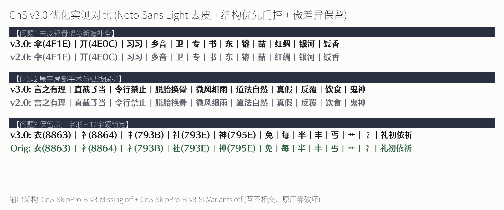

# CnS-

基于 [`FOT-SkipPro-B.OTF`](./FOT-SkipPro-B.OTF) 既有 **7,912 个原版汉字**，以 **v3.0 去皮轻骨架 + 结构优先门控 + 微差异保留 + 双独立字库分卷输出** 方案（详见 [`Plan3.0.md`](./Plan3.0.md)），在零使用思源宋体与中粗黑体轮廓的前提下，通过 **`Noto Sans CJK Light (wght=300)`**、均匀骨架距离场、双倍角切向场、Stage 0a/0b 局部手术与局部重绘、曲率掩膜曲线优化以及硬拦截门控（`StructuralGateV3`），面向 **《通用规范汉字表》8,105 全集** 完成独立分卷重构与原厂字形保护。

---

## v3.0 核心成果与下载

> **双独立字库输出（默认互不相交、不污染原厂）**：  
> - **缺字补全独立字库**：[`outputs/CnS-SkipPro-B-v3-Missing.otf`](./outputs/CnS-SkipPro-B-v3-Missing.otf)（约 `2.2 MB`，仅包含 `.notdef` 与原字体缺失的 **`4,088`** 个简体/增补字形，`cmap ∩ FOT-SkipPro-B == ∅`）  
> - **陆标异形重绘独立字库**：[`outputs/CnS-SkipPro-B-v3-SCVariants.otf`](./outputs/CnS-SkipPro-B-v3-SCVariants.otf)（约 `784 KB`，仅包含 `.notdef` 与非豁免日/陆异形的 **`1,183`** 个重绘字形，`cmap ⊆ FOT-SkipPro-B`）

### 1. v3.0 实测对比样张



### 2. M0 ～ M4 关键定量指标

- **M0 结构优先门控回归测试**（[`outputs/v3_m0_gate_regression.json`](./outputs/v3_m0_gate_regression.json)）：
  - 正样本（`1,000` 个 `JP==SC` `SkipPro-B` 原字）：**`973 / 1000`（`97.30%`）**
  - `NEG1`（`300` 个日标异形冒充陆标）：**`0 / 300`（`0.00%`）**
  - `NEG2`（形近错字替换 `真↔直, 徽↔微, ...`）：**`0 / 11`（`0.00%`）**
  - `NEG3`（繁体冒充简体 `紅→红, 銀→银, ...`）：**`0 / 20`（`0.00%`）**
  - `NEG4`（`300` 个随机错字）：**`0 / 300`（`0.00%`）**
- **M1 通规 8,105 字分类与原厂保留**（[`outputs/v3_m1_classification.json`](./outputs/v3_m1_classification.json) & [`manual_review/v3_keep_vs_replace.png`](./manual_review/v3_keep_vs_replace.png)）：
  - `MISSING`（原字库缺字）：**`4,101`** 字
  - `SC_VARIANT`（非豁免陆标异形）：**`1,422`** 字（较 v2 的 `2,239` 大幅收窄）
  - 原厂保留共 **`2,582`** 字：`KEEP_POLICY` 通规内 **`8`** 字（连同非通规部首共 **12 字强锁定保留原厂**：`/uni4E10/uni4E30/uni514D/uni51AB/uni534A/uni6BCF/uni793B/uni793E/uni795E/uni8279/uni8863/uni8864`）、`KEEP_SAME_GID` **`1,453`** 字、`KEEP_V1_V2` 微差异豁免 **`395`** 字（含「竖弯钩 ↔ 竖+提」及 `ネ ↔ 礻`）、`KEEP_SKIPPRO_ALREADY_SC` 原字已吻合陆标 **`726`** 字
- **M2 `Noto Sans Light` 去皮可控消融（80 严格保留字）**（[`outputs/v3_m2_ablation_report.json`](./outputs/v3_m2_ablation_report.json)）：
  - 风格泄露率单调下降：`Group B Sans Light (6ep): 1.1927` → `Group C +均匀骨架 (6ep): 1.1731` → `Group D +切向+抖动 (6ep): 1.1662` → **`Group D 最终 18ep: 1.1080`**（低于 `Group A v2 基线: 1.1382`）
  - 4 个无参考监督损失在 18 轮内全部真实下降（`sdf_l1 -19.62%`、`grad_l1 -18.33%`、`stem_norm -24.50%`、`cldice -27.94%`）
- **M3 精简 104 字人工精修母件字库**（[`manual_review/CnS-Manual-Master-Bank.otf`](./manual_review/CnS-Manual-Master-Bank.otf)）：
  - 已严格移除全部 **12 个强锁定保留原厂字形的码位**（`116 → 104` 字），`gate_pass_count = 103 / 104 (99.04%)`，支持直接使用 FontCreator / FontLab 编辑（见 [`manual_review/MANUAL_EDIT_GUIDE.md`](./manual_review/MANUAL_EDIT_GUIDE.md) 与 [`manual_review/master_bank_wireframe.png`](./manual_review/master_bank_wireframe.png)）
- **M4 分卷输出与合并覆盖统计**（[`outputs/v3_metrics.json`](./outputs/v3_metrics.json)）：
  - `Missing.otf` 打包 **`4,088 / 4,106`（`99.56%`）**：`MasterDirect 81 + Tier1 1,739 + Tier3_DeskinnedSDF 2,268`
  - `SCVariants.otf` 打包 **`1,183` 字**：其中 `Tier 0` 原厂局部手术 / 局部重绘 **`1,073` 字（占已入库异形字 `90.70%`，占全部目标 `75.46%`）**，`Tier1 38`、`Tier3_DeskinnedSDF 72`
  - 联合原版 `FOT-SkipPro-B.OTF` 后通规 8,105 字实测覆盖 **`8,087 / 8,105`（`99.78%`）**，总门控通过率 **`95.35%`**；全部 **`257`** 个未过门控拦截字形已阻止污染输出，统一隔离在 [`manual_review/v3_needs_review.otf`](./manual_review/v3_needs_review.otf) 与 [`manual_review/v3_needs_review.json`](./manual_review/v3_needs_review.json)
  - 全部硬不变量实测为 `true`：`missing_disjoint_variants`、`missing_disjoint_base`、`variants_subset_base`、`hard_keep_12_point_exact`、`master_bank_glyph_count = 104`

### 3. 可选合并工具

v3.0 默认严格分卷输出 `Missing.otf` 与 `SCVariants.otf`。若下游软件需要单一字体，可通过可选工具显式合并（并自动校验上述 12 个码位与原厂点对点完全一致）：

```bash
python scripts/v3_merge_fonts.py --emit_merged
```

---

## 目录结构与复现

```text
CnS-/
├── FOT-SkipPro-B.OTF                          # 基底原厂字体 (1000 UPEM, CFF, 7,912 CJK)
├── Plan3.0.md                                 # v3.0 审计与优化设计方案
├── data_v3/
│   └── variant_policy.tsv                     # 变体保留/替换策略表（强锁定 12 个 KEEP 码位）
├── data_v2/tg8105/                            # 《通用规范汉字表》一/二/三级字表 (3,500+3,000+1,605)
├── src/v3/
│   ├── hb_light.py                            # Noto Sans Light (`wght=300`) 提取、均匀骨架与切向场
│   ├── structural_gate.py                     # StructuralGateV3（零思源衬线依赖、零直线奖励 Hack）
│   ├── variant_classifier.py                  # V1/V2 微差异豁免、原厂已达标直留与全表分类
│   ├── model_v3.py                            # LocalStrokeSDFNetV3 去皮轻骨架 SDF 生成器
│   ├── losses_v3.py                           # 目标独占几何/法向监督、Soft-clDice 与死锁监测器
│   ├── curve_constrain.py                     # 曲率掩膜保护 (`no_snap_mask`) + Hausdorff<=4u 回退守卫
│   ├── local_inpainter.py                     # DonorBankV3、Stage 0a 纯矢量手术与 Stage 0b 局部 SDF 重绘
│   └── otf_packager.py                        # 独立分卷 OpenType CFF 打包器 (`cffsubr`)
├── scripts/
│   ├── v3_gate_regression.py                  # M0 结构优先门控 5 组回归基准测试
│   ├── v3_classify_and_preview.py             # M1 通规全表分类与 KEEP/REPLACE 三联对比图
│   ├── v3_train_and_ablate.py                 # M2 Light 缓存、4 组消融实验与 18 轮正式训练
│   ├── v3_build_master_bank.py                # M3 构建 104 字精简母件库
│   ├── v3_build_tg8105.py                     # M4 全库合成、门控拦截与双独立 OTF 打包
│   └── v3_merge_fonts.py                      # 可选：合并双独立字体并执行 12 字点对点校验
├── checkpoints/
│   ├── v3_zh_sdf_light.pt                     # [v3.0] 18 轮去皮轻骨架局部生成器权重
│   └── v2_zh_sdf_s256.pt                      # [v2.0] 历史对照权重
├── manual_review/
│   ├── CnS-Manual-Master-Bank.otf             # [v3.0] 104 字精简人工精修母件库（已剔除 12 保留字）
│   ├── MANUAL_EDIT_GUIDE.md                   # v3.0 母件编辑与下游传播指南
│   ├── master_bank_wireframe.png              # 104 母件控制点 Wireframe 预览
│   ├── master_bank_hashes.json                # 改动指纹、来源与门控记录
│   ├── v3_keep_vs_replace.png                 # KEEP_POLICY / V1-V2 / ALREADY_SC / SC_VARIANT 对照图
│   └── v3_needs_review.otf/.json              # 未通过 StructuralGateV3 拦截待审字形与诊断日志
└── outputs/
    ├── CnS-SkipPro-B-v3-Missing.otf           # [v3.0] 缺字补全独立字库 (4,088 字 + .notdef)
    ├── CnS-SkipPro-B-v3-SCVariants.otf        # [v3.0] 陆标异形重绘独立字库 (1,183 字 + .notdef)
    ├── v3_vs_v2_showcase.png                  # [v3.0] 问题 1/2/3 优化实测对比图
    ├── v3_metrics.json                        # [v3.0] M4 全库指标与硬不变量校验报告
    ├── v3_glyph_manifest.json                 # [v3.0] 逐字合成来源、节点与门控明细
    ├── v3_m0_gate_regression.json             # [v3.0] M0 门控回归测试报告
    ├── v3_m1_classification.json              # [v3.0] M1 8,105 字分类汇总
    ├── v3_m2_ablation_report.json             # [v3.0] M2 四组消融与 18 轮收敛报告
    └── CnS-SkipPro-B-TG8105-SC.otf            # [v2.0] 早期单包合集对照产物
```

### 从头完整复现 v3.0 流程

```bash
pip install -r requirements.txt

# M0: 验证结构优先门控 (POS >= 97%, NEG1..4 == 0%)
python scripts/v3_gate_regression.py --noto_sans /path/to/NotoSansCJK-VF.ttc

# M1: 通规 8,105 字分类与保留策略检查
python scripts/v3_classify_and_preview.py --noto_sans /path/to/NotoSansCJK-VF.ttc

# M2: 构建去皮 Sans Light 缓存、运行 A/B/C/D 消融并训练 18 轮 Group D 模型
python scripts/v3_train_and_ablate.py \
  --noto_sans /path/to/NotoSansCJK-VF.ttc \
  --noto_serif /path/to/NotoSerifCJK-VF.ttc \
  --ablation_epochs 6 --full_epochs 18

# M3: 构建 104 字精简人工精修母件库（已移除 12 个 KEEP 码位）
python scripts/v3_build_master_bank.py --noto_sans /path/to/NotoSansCJK-VF.ttc

# M4: 输出双独立字库（Missing.otf + SCVariants.otf）并验证全套硬不变量
python scripts/v3_build_tg8105.py --noto_sans /path/to/NotoSansCJK-VF.ttc
```

---

> **v2.0 / v1.0 历史归档**：早期单包合集脚本与文档仍保留于 `src/v2/`、`scripts/v2_*.py`、`plan2.0.md` 与 `PLAN.md` 供对照评测。
