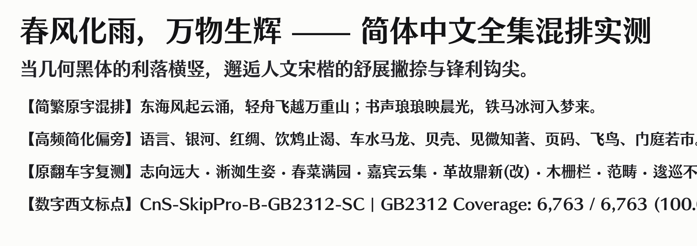
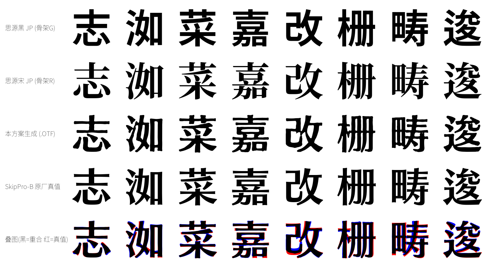

# CnS-

基于 [`FOT-SkipPro-B.OTF`](./FOT-SkipPro-B.OTF) 既有 **7,912 个原版汉字**为唯一风格真值，仅以**思源宋体 / 思源黑体**作为拓扑结构参考骨架，通过**受限感受野局部多尺度卷积距离场网络（`LocalStrokeSDFNet`）+ `PatchGAN` 锐角对抗判别器 + 正交吸附三次贝塞尔转曲**补全简体中文字符集的字体工程项目。

---

## 成果速览与字体下载

- 🔤 **GB2312 全集简中补全版字体下载**：[**`outputs/CnS-SkipPro-B-GB2312-SC.otf`**](./outputs/CnS-SkipPro-B-GB2312-SC.otf)
  - **GB2312 一级常用字（3,755 字）覆盖率**：**`100.00%`**（原库 66.6%，补齐 1,254 字）
  - **GB2312 全集（6,763 字）覆盖率**：**`100.00%`**（原库 55.9%，补齐 **2,983** 字）
  - **总 CJK 汉字数**：**`10,895` 字**（完整保留原厂全部西文、假名、标点、直排度量与 OpenType 特性）
- 🧠 **预训练 EMA 权重存档**：[`checkpoints/cns_local_sdf_s256_c64.pt`](./checkpoints/cns_local_sdf_s256_c64.pt)

### 1. 原厂汉字与新生成简体字混排实测


### 2. 留出验证集对比（彻底解决全局扩散模型 `zi2zi-JiT` 偏旁幻觉过拟合）

- 80 字严格留出验证集像素交并比（IoU）：从思源宋骨架的 `0.6486` / 思源黑的 `0.7066` 提升至 **`0.7816`**（原 8 个翻车字子集达 **`0.7941`**），包络外幻觉墨迹率仅 `0.42%`，**零偏旁篡改**。

### 3. 全库零样本简化偏旁（`讠/钅/纟/饣/车/东/书/专/买/风/龙/业`）生成细节


---

## 目录结构与快速复现

```text
CnS-/
├── FOT-SkipPro-B.OTF                  # 基底字体 (1000 UPEM, CFF, 7,912 CJK)
├── PLAN.md                            # 完整技术方案与模型选型复盘文档
├── src/
│   ├── glyph_renderer.py              # 1000-UPEM 左基线像素级对齐渲染器
│   ├── sdf_utils.py                   # 超采样亚像素 SDF 与四通道互补张量构建
│   ├── model.py                       # 受限感受野 LocalStrokeSDFNet + LocalPatchDiscriminator
│   ├── losses.py                      # 零等值面边界加权 L1 + Sobel 法向梯度损失
│   ├── vectorizer.py                  # SDF 零等值面提取、绕序校验、正交吸附与有界三次贝塞尔拟合
│   ├── otf_builder.py                 # CID-Keyed CFF 字形回写封装与拓扑防幻觉 QA
│   └── component_composer.py          # 原厂 CFF 矢量部件提取与仿射拼合工具
├── scripts/
│   ├── train_gpu_5070ti.py            # 全量 7,832 字 bfloat16 对抗训练 + GB2312 批量合成脚本
│   ├── generate_simplified_font.py    # 基于已训练权重对任意自定义缺字集批量补字封装
│   └── run_m1_poc.py                  # 轻量小样本快速原型验证脚本
├── checkpoints/
│   └── cns_local_sdf_s256_c64.pt      # 训练完成的生成器 EMA 权重
└── outputs/
    ├── CnS-SkipPro-B-GB2312-SC.otf    # 编译完成的 GB2312 100% 覆盖简中字体
    └── gpu_metrics.json               # 验证集与合成定量指标报告
```

### 使用已有权重按需补全自定义汉字

```bash
pip install -r requirements.txt

python scripts/generate_simplified_font.py \
  --skip_otf FOT-SkipPro-B.OTF \
  --noto_serif /path/to/NotoSerifCJK-VF.ttc \
  --noto_sans /path/to/NotoSansCJK-VF.ttc \
  --checkpoint checkpoints/cns_local_sdf_s256_c64.pt \
  --base_channels 64 \
  --charset custom --chars "镕喆淼龘" \
  --out_otf outputs/CnS-Custom.otf
```

### 从头完整复现 GPU 训练与 GB2312 打包

```bash
python scripts/train_gpu_5070ti.py \
  --skip_otf FOT-SkipPro-B.OTF \
  --noto_serif /path/to/NotoSerifCJK-VF.ttc \
  --noto_sans /path/to/NotoSansCJK-VF.ttc \
  --canvas_size 256 --patch_size 96 --base_channels 64 \
  --epochs 24 --batch_size 64 --build_gb2312
```

---

## 技术方案与实验复盘文档

详见 📄 **[《CnS- 简中字符集扩充与风格迁移技术方案》（`PLAN.md`）](./PLAN.md)**。
