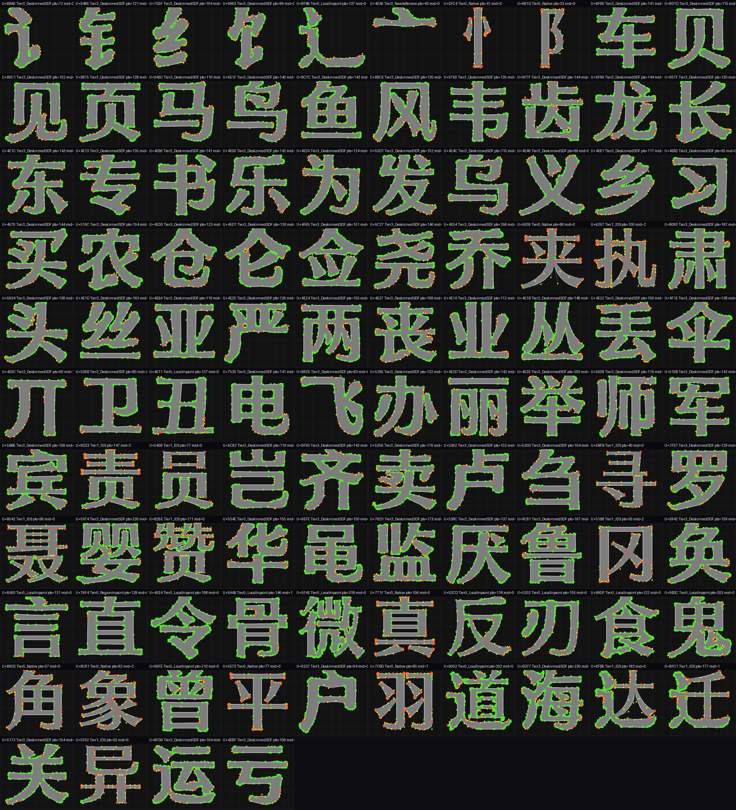

# CnS-Manual-Master-Bank (v3.0) 人工精修指引

本目录下的 [`CnS-Manual-Master-Bank.otf`](./CnS-Manual-Master-Bank.otf) 是 v3.0 的精简高复用核心母件字库，共包含 **104 个字符**，可用 **FontCreator / FontLab / Glyphs / FontForge** 直接打开编辑。

> **已强制移除以下 12 个保留原厂字形的码位（共 116 → 104 字）**：  
> `丐(U+4E10)` `丰(U+4E30)` `免(U+514D)` `冫(U+51AB)` `半(U+534A)` `每(U+6BCF)` `礻(U+793B)` `社(U+793E)` `神(U+795E)` `艹(U+8279)` `衣(U+8863)` `衤(U+8864)`

## 修改后如何自动传播到独立分卷字库？

编辑保存 `manual_review/CnS-Manual-Master-Bank.otf`（**保持每个字的 Unicode 码位不变**）后，运行：

```bash
python scripts/v3_build_tg8105.py --master_otf manual_review/CnS-Manual-Master-Bank.otf --noto_sans <NotoSansCJK-VF.ttc>
```

全库合成器会优先读取你手动编辑过的母件，并将更新分别输出到两个独立字库：
- `outputs/CnS-SkipPro-B-v3-Missing.otf`（原字体缺失字补全）
- `outputs/CnS-SkipPro-B-v3-SCVariants.otf`（非豁免中日异形重绘字）

## 收录字形分组

1. **高频偏旁母件 (8 字)**：`讠钅纟饣辶亠忄阝`
2. **高频简体与独体根字 (72 字)**：`车贝见页马鸟鱼风韦齿龙长东专书乐为发乌义乡习买农仓仑佥尧乔夹执肃头丝亚严两丧业丛丢伞丌卫丑电飞办丽举师军宾责员岂齐卖卢刍寻罗聂婴赞华黾监厌鲁冈奂`
3. **陆标异形母件 (24 字)**：`言直令骨微真反刃食鬼角象曾平户羽道海达迁关异运亏`

## 节点 Wireframe 预览图



## 各母件生成来源、门控与节点统计

| 字符 | 码位 | 合成路径 | Gate | On-Curve 点数 | 直线中段冗余节点 |
| :---: | :---: | :--- | :---: | :---: | :---: |
| 忄 | `U+5FC4` | `Tier0_Native` | PASS | 41 | 0 |
| 阝 | `U+961D` | `Tier0_Native` | PASS | 33 | 0 |
| 夹 | `U+5939` | `Tier0_Native` | PASS | 86 | 0 |
| 真 | `U+771F` | `Tier0_Native` | PASS | 106 | 0 |
| 角 | `U+89D2` | `Tier0_Native` | PASS | 57 | 0 |
| 象 | `U+8C61` | `Tier0_Native` | PASS | 82 | 2 |
| 平 | `U+5E73` | `Tier0_Native` | PASS | 77 | 0 |
| 羽 | `U+7FBD` | `Tier0_Native` | PASS | 85 | 1 |
| 辶 | `U+8FB6` | `Tier0_LocalInpaint` | PASS | 137 | 0 |
| 丑 | `U+4E11` | `Tier0_LocalInpaint` | PASS | 137 | 0 |
| 言 | `U+8A00` | `Tier0_LocalInpaint` | PASS | 131 | 0 |
| 直 | `U+76F4` | `Tier0_RegionInpaint` | PASS | 128 | 0 |
| 令 | `U+4EE4` | `Tier0_LocalInpaint` | PASS | 198 | 0 |
| 骨 | `U+9AA8` | `Tier0_LocalInpaint` | PASS | 146 | 1 |
| 微 | `U+5FAE` | `Tier0_LocalInpaint` | PASS | 318 | 0 |
| 反 | `U+53CD` | `Tier0_LocalInpaint` | PASS | 118 | 0 |
| 刃 | `U+5203` | `Tier0_LocalInpaint` | PASS | 155 | 0 |
| 食 | `U+98DF` | `Tier0_LocalInpaint` | PASS | 222 | 0 |
| 鬼 | `U+9B3C` | `Tier0_LocalInpaint` | PASS | 203 | 0 |
| 曾 | `U+66FE` | `Tier0_LocalInpaint` | PASS | 210 | 0 |
| 讠 | `U+8BA0` | `Tier3_DeskinnedSDF` | PASS | 72 | 0 |
| 钅 | `U+9485` | `Tier3_DeskinnedSDF` | PASS | 121 | 0 |
| 纟 | `U+7E9F` | `Tier3_DeskinnedSDF` | PASS | 104 | 0 |
| 饣 | `U+9963` | `Tier3_DeskinnedSDF` | PASS | 99 | 0 |
| 车 | `U+8F66` | `Tier3_DeskinnedSDF` | PASS | 141 | 0 |
| 贝 | `U+8D1D` | `Tier3_DeskinnedSDF` | PASS | 115 | 0 |
| 见 | `U+89C1` | `Tier3_DeskinnedSDF` | PASS | 102 | 0 |
| 页 | `U+9875` | `Tier3_DeskinnedSDF` | PASS | 128 | 1 |
| 马 | `U+9A6C` | `Tier3_DeskinnedSDF` | PASS | 110 | 0 |
| 鸟 | `U+9E1F` | `Tier3_DeskinnedSDF` | PASS | 140 | 0 |
| 鱼 | `U+9C7C` | `Tier3_DeskinnedSDF` | PASS | 143 | 1 |
| 风 | `U+98CE` | `Tier3_DeskinnedSDF` | PASS | 130 | 0 |
| 韦 | `U+97E6` | `Tier3_DeskinnedSDF` | PASS | 135 | 0 |
| 齿 | `U+9F7F` | `Tier3_DeskinnedSDF` | PASS | 144 | 0 |
| 龙 | `U+9F99` | `Tier3_DeskinnedSDF` | PASS | 144 | 0 |
| 长 | `U+957F` | `Tier3_DeskinnedSDF` | PASS | 130 | 0 |
| 东 | `U+4E1C` | `Tier3_DeskinnedSDF` | PASS | 143 | 0 |
| 专 | `U+4E13` | `Tier3_DeskinnedSDF` | PASS | 135 | 0 |
| 书 | `U+4E66` | `Tier3_DeskinnedSDF` | PASS | 141 | 0 |
| 乐 | `U+4E50` | `Tier3_DeskinnedSDF` | PASS | 142 | 0 |
| 为 | `U+4E3A` | `Tier3_DeskinnedSDF` | PASS | 124 | 0 |
| 发 | `U+53D1` | `Tier3_DeskinnedSDF` | PASS | 152 | 0 |
| 乌 | `U+4E4C` | `Tier3_DeskinnedSDF` | PASS | 115 | 0 |
| 义 | `U+4E49` | `Tier3_DeskinnedSDF` | PASS | 99 | 0 |
| 乡 | `U+4E61` | `Tier3_DeskinnedSDF` | PASS | 117 | 0 |
| 习 | `U+4E60` | `Tier3_DeskinnedSDF` | PASS | 95 | 0 |
| 买 | `U+4E70` | `Tier3_DeskinnedSDF` | PASS | 144 | 1 |
| 农 | `U+519C` | `Tier3_DeskinnedSDF` | PASS | 154 | 0 |
| 仓 | `U+4ED3` | `Tier3_DeskinnedSDF` | PASS | 123 | 0 |
| 仑 | `U+4ED1` | `Tier3_DeskinnedSDF` | PASS | 126 | 0 |
| 尧 | `U+5C27` | `Tier3_DeskinnedSDF` | PASS | 146 | 0 |
| 乔 | `U+4E54` | `Tier3_DeskinnedSDF` | PASS | 158 | 1 |
| 肃 | `U+8083` | `Tier3_DeskinnedSDF` | PASS | 187 | 0 |
| 头 | `U+5934` | `Tier3_DeskinnedSDF` | PASS | 136 | 0 |
| 丝 | `U+4E1D` | `Tier3_DeskinnedSDF` | PASS | 163 | 1 |
| 严 | `U+4E25` | `Tier3_DeskinnedSDF` | PASS | 126 | 0 |
| 两 | `U+4E24` | `Tier3_DeskinnedSDF` | PASS | 155 | 2 |
| 丧 | `U+4E27` | `Tier3_DeskinnedSDF` | PASS | 169 | 0 |
| 业 | `U+4E1A` | `Tier3_DeskinnedSDF` | PASS | 112 | 0 |
| 伞 | `U+4F1E` | `Tier3_DeskinnedSDF` | PASS | 138 | 1 |
| 丌 | `U+4E0C` | `Tier3_DeskinnedSDF` | PASS | 60 | 1 |
| 卫 | `U+536B` | `Tier3_DeskinnedSDF` | PASS | 80 | 2 |
| 电 | `U+7535` | `Tier3_DeskinnedSDF` | PASS | 141 | 0 |
| 飞 | `U+98DE` | `Tier3_DeskinnedSDF` | PASS | 83 | 0 |
| 办 | `U+529E` | `Tier3_DeskinnedSDF` | PASS | 132 | 0 |
| 丽 | `U+4E3D` | `Tier3_DeskinnedSDF` | PASS | 142 | 1 |
| 举 | `U+4E3E` | `Tier3_DeskinnedSDF` | PASS | 200 | 0 |
| 师 | `U+5E08` | `Tier3_DeskinnedSDF` | PASS | 119 | 0 |
| 齐 | `U+9F50` | `Tier3_DeskinnedSDF` | PASS | 143 | 0 |
| 卢 | `U+5362` | `Tier3_DeskinnedSDF` | PASS | 102 | 1 |
| 刍 | `U+520D` | `Tier3_DeskinnedSDF` | PASS | 104 | 0 |
| 监 | `U+76D1` | `Tier3_DeskinnedSDF` | PASS | 173 | 0 |
| 户 | `U+6237` | `Tier3_DeskinnedSDF` | PASS | 94 | 0 |
| 亠 | `U+4EA0` | `Tier3_NeedsReview` | REVIEW | 43 | 0 |
| 执 | `U+6267` | `Tier1_IDS` | PASS | 100 | 2 |
| 责 | `U+8D23` | `Tier1_IDS` | PASS | 147 | 2 |
| 员 | `U+5458` | `Tier1_IDS` | PASS | 77 | 0 |
| 寻 | `U+5BFB` | `Tier1_IDS` | PASS | 40 | 0 |
| 聂 | `U+8042` | `Tier1_IDS` | PASS | 96 | 0 |
| 赞 | `U+8D5E` | `Tier1_IDS` | PASS | 171 | 0 |
| 冈 | `U+5188` | `Tier1_IDS` | PASS | 56 | 2 |
| 达 | `U+8FBE` | `Tier1_IDS` | PASS | 183 | 0 |
| 迁 | `U+8FC1` | `Tier1_IDS` | PASS | 177 | 1 |
| 异 | `U+5F02` | `Tier1_IDS` | PASS | 55 | 0 |
| 道 | `U+9053` | `Tier0_LocalInpaint` | PASS | 292 | 0 |
| 佥 | `U+4F65` | `Tier3_DeskinnedSDF` | PASS | 151 | 1 |
| 亚 | `U+4E9A` | `Tier3_DeskinnedSDF` | PASS | 119 | 0 |
| 丛 | `U+4E1B` | `Tier3_DeskinnedSDF` | PASS | 148 | 0 |
| 丢 | `U+4E22` | `Tier3_DeskinnedSDF` | PASS | 156 | 1 |
| 军 | `U+519B` | `Tier3_DeskinnedSDF` | PASS | 142 | 0 |
| 宾 | `U+5BBE` | `Tier3_DeskinnedSDF` | PASS | 158 | 0 |
| 岂 | `U+5C82` | `Tier3_DeskinnedSDF` | PASS | 119 | 1 |
| 卖 | `U+5356` | `Tier3_DeskinnedSDF` | PASS | 176 | 0 |
| 罗 | `U+7F57` | `Tier3_DeskinnedSDF` | PASS | 129 | 0 |
| 婴 | `U+5A74` | `Tier3_DeskinnedSDF` | PASS | 230 | 0 |
| 华 | `U+534E` | `Tier3_DeskinnedSDF` | PASS | 155 | 0 |
| 黾 | `U+9EFE` | `Tier3_DeskinnedSDF` | PASS | 150 | 1 |
| 厌 | `U+538C` | `Tier3_DeskinnedSDF` | PASS | 137 | 0 |
| 鲁 | `U+9C81` | `Tier3_DeskinnedSDF` | PASS | 167 | 3 |
| 奂 | `U+5942` | `Tier3_DeskinnedSDF` | PASS | 159 | 0 |
| 关 | `U+5173` | `Tier3_DeskinnedSDF` | PASS | 154 | 0 |
| 运 | `U+8FD0` | `Tier3_DeskinnedSDF` | PASS | 164 | 1 |
| 亏 | `U+4E8F` | `Tier3_DeskinnedSDF` | PASS | 106 | 0 |
| 海 | `U+6D77` | `Tier3_DeskinnedSDF` | PASS | 230 | 0 |
