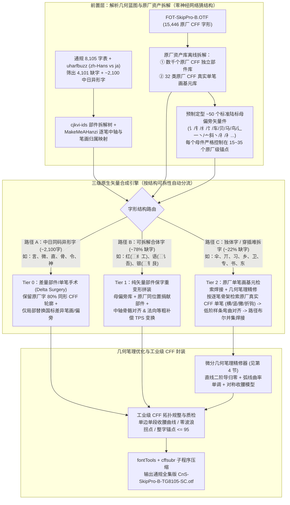

# CnS- 字体优化技术方案（v2.0：原生矢量优先与几何笔理约束架构）

> [!IMPORTANT]
> **版本演进核心目标（v1 → v2.0）**：
> 1. **目标字集全面升级**：切换至国家《通用规范汉字表》全集 **8,105 字**（基于 [`shengdoushi/common-standard-chinese-characters-table`](https://github.com/shengdoushi/common-standard-chinese-characters-table) 的一、二、三级字表），并**将共码汉字中的「日标 vs 国标异形字」（如 `微、言、直、令、骨`）全部纳入陆标化重制范围**。
> 2. **生成范式根本反转**：摒弃“整字降维成像素/SDF → 神经网络涂抹 → 等值面描边猜曲线”的有损链路；确立 **「无 Content Encoder 几何直驱：原厂 `CFF` 部件变形拼装为主（~78%）+ 原厂单笔画基元焊接攻克独体字（~22%）+ 微分几何直/弧曲率奖励精修」** 的原生矢量优先（Vector-First）架构，从根源上终结控制点爆炸与独体字笔画软塌。

---

## 1. 第一阶段（v1 栅格 SDF 版）实测缺陷深度复盘

对 v1 生成的 `CnS-SkipPro-B-GB2312-SC.otf` 在专业字体编辑器中进行节点级检验后，暴露出六大核心问题及其底层成因：

| 编号 | 实测痛点与典型案例 | 底层几何与算法根因剖析 |
| :---: | :--- | :--- |
| **1** | **描边矢量全碎成曲线、控制点爆炸** *（如 `红` 右侧 `工` 出现数十个波浪控制点，而原厂 `紅` 右侧 `工` 仅 **16 个干净锚点**）* | ① **有损光栅化往返**：将原本干净的矢量降维成 `256×256` 栅格，神经网络产生 `±0.4px` 亚像素微波纹，Marching Squares + 细容差（`0.3 UPEM`）忠实拟合每一处像素噪点，把单条长边切碎成十余段微弯 `curveTo`； ② **未区分原厂几何图元**：原厂 `SkipPro-B` 的“直线干”实为**四角点 + 整边单段极微内凹收腰三次曲线（0 中间节点）**，传统描边器无法识别该图元； ③ **无谓重绘现成部件**：`红` 右部 `工` 在原库 `紅 (U+7D05)` 中本有 100% 现成的 16 锚点原厂轮廓，v1 却将其光栅化重画。 |
| **2** | **中日同码异形字漏网未修** *（如 `微 U+5FAE` 中部粘连、`言 U+8A00` 顶部为日标短横而非国标斜点 `丶`）* | ① v1 仅按 `cmap` 码位缺失筛查目标字，忽略了已覆盖码位中的 **JIS 日标字形 vs GB 国标新字形差异**； ② **底层字体塑形隐患**：`NotoSerif/SansCJK-VF.ttc` 内部 5 个子字体共享基础 `cmap`，若不通过 HarfBuzz（`uharfbuzz`）显式激活 `language="zh-Hans"` 的 `GSUB locl` 特性，无 `libraqm` 的 Windows 环境即便指定 `index=2` 仍会回退输出日标骨架！ |
| **3** | **GB2312 覆盖面不足** | GB2312（6,763 字）缺少大量现代姓氏、地名、科技常用字（如三级字表中的 `镕、喆、淼` 等），需切换为 **《通用规范汉字表》8,105 全集**。 |
| **4** | **不可再拆的独体字更易翻车** *（如 `伞 4F1E`、`丌 4E0C`、`习`、`乡`、`卫` 出现笔画粗细掐腰、折角软塌、横端下垂）* | 独体字笔画稀疏、周围留白极大，缺乏密集部件遮掩。像素卷积网络在局部感受野内无法感知整根长笔画的首尾贯通刚性，导致长横/长撇中途粗细波动（“糖葫芦效应”），折角处被平滑核腐蚀软化。 |
| **5** | **训练奖励未学到“直”与“弧”的笔理** *（仅靠像素扩散/填充模仿局部边缘）* | 损失函数仅有逐像素 `L1(SDF)` + 一阶 `Sobel` + `34×34 PatchGAN`。一阶损失对二阶曲率震荡（正负交替的 S 形微波纹）不敏感，而像素级 `PatchGAN` 为欺骗卷积判别器反而高频注入 `1~2px` 边缘伪纹理，网络从未被奖励“横竖干必须零拐点平直收腰、撇捺弧必须曲率单调”。 |
| **6** | **架构冗余：本无需 Content Encoder** *（微调字形风格而非重做艺术字，绝大多数合体字可直接走变形拼接）* | 本项目已有思源 `SC` 作为 **100% 精确的国标矢量几何参考**，部件应该放在哪、每一笔从哪到哪在输入矢量中已是解析已知量！引入神经网络编码器去“提取并重猜内容结构”完全是舍近求远，直接在矢量域做部件与笔画级非刚性配准拼装才是最短无损路径。 |

---

## 2. 《通用规范汉字表》（8,105 字）精确盘点与三池分流

拉取 [`shengdoushi/common-standard-chinese-characters-table`](https://github.com/shengdoushi/common-standard-chinese-characters-table)（`level-1.txt` / `level-2.txt` / `level-3.txt`），结合 HarfBuzz 显式 `language="ja"` vs `language="zh-Hans"` 塑形比对 [`FOT-SkipPro-B.OTF`](./FOT-SkipPro-B.OTF)，得出精确全集盘点数据：

### 2.1 通规三级字表缺口统计

| 字表层级 | 官方字数 | `SkipPro-B` 已含码位 | **原库完全缺失数** | 说明 |
| :--- | :---: | :---: | :---: | :--- |
| **一级字表（`level-1.txt`）** | 3,500 | 2,350 | **1,150** | 高频核心常用字（占日常阅读 99% 字频） |
| **二级字表（`level-2.txt`）** | 3,000 | 1,356 | **1,644** | 次常用字、书面与专业词汇用字 |
| **三级字表（`level-3.txt`）** | 1,605 | 298 | **1,307** | 人名姓氏、地名、科学技术与文言常用字 |
| **通规全集合计** | **8,105** | **4,004** | **4,101** | — |

### 2.2 已含 4,004 共码字的「中日字形差异（JP vs CN）」定量分级

通过对比思源宋体 Bold 在 `ja`（日标）与 `zh-Hans`（陆标国标新字形）下的精确塑形交并比（IoU）与连通拓扑，将原库已有的 4,004 个通规字拆分为三档：

| 共码字分级 | 字数 | 判定标准 | 典型实测字符（括号内为中日字形 IoU） | v2.0 处置策略 |
| :--- | :---: | :---: | :--- | :--- |
| **A. 同码同形直通池** | **1,686** | `IoU ≥ 0.97` 且连通数一致 | `晴(1.00)`、`起(1.00)`、`春`、`山`、`水` | **100% 原样保留** `FOT-SkipPro-B` 原厂 `CFF` 轮廓，零改动 |
| **B. 显著中日异形池** | **1,808** | `IoU < 0.85`（笔画拓扑/点向不同） | `直(0.27)`、`言(0.39)`、`令(0.43)`、`刃(0.66)`、`海(0.72)`、`微(0.74)`、`真(0.75)`、`社(0.77)`、`神(0.77)`、`反(0.84)`、`衣(0.85)` | **全部纳入重制队列**：优先走「差量部件/笔画手术」，保留无差异半边，仅替换异形部件 |
| **C. 轻度笔势差异池** | **510** | `0.85 ≤ IoU < 0.97`（局部触离/点位） | `道(0.86)`（走之底一二点）、`骨(0.89)`（下月内钩方向） | 按陆标偏旁规则表（`辶、骨、饣/食、礻/示、亠` 等）精准筛入差量替换队列 |

> **v2.0 最终生成总规模**：`4,101`（原库缺失字） + `~2,100`（显著及规则命中的中日异形字） ≈ **`6,200` 个陆标规范字形**，加上 `1,900+` 个原样保留的同形原厂字，实现 **8,105 通规全集 100% 纯正陆标字形覆盖**。

---

## 3. CnS v2.0 核心架构：无编码器三级原生矢量合成管线

彻底取消神经网络 Content Encoder，改以 **`uharfbuzz` 提取的思源 `SC`（`zh-Hans`）原生矢量 + 开源结构库（`cjkvi-ids` + `MakeMeAHanzi`）** 作为解析几何蓝图，构建三级矢量优先流水线：

---

### 3.1 Tier 0 & Tier 1（主力路径，覆盖 ~80% 任务）：纯矢量部件变形拼装与差量手术

直接回应 **痛点 1、痛点 2、痛点 6**：**凡是原库已有部件或高频简化偏旁能组合出的字，100% 在纯三次贝塞尔控制点空间完成，绝不转成位图重描！**

1. **一次性精制定型 ~50 个「陆标核心母偏旁矢量库」**：
   * 范围：涵盖《汉字简化方案》全部高频类推简化偏旁（`讠、钅、纟、饣、车、贝、见、页、马、鸟、门、风、韦、齿、龙` 等）及高频陆标异形偏旁（国标一点 `辶`、斜点 `亠`、斜点 `言`、竖心 `忄`、示旁 `礻`、衣旁 `衤`、断笔 `艹` 等）。
   * 制作方式：直接用原厂 `SkipPro-B` 拆出的真实单笔（如原厂水滴点 `丶` + 原厂折提 `㇊` 拼出 `讠`；原厂撇折 + 提拼出 `纟`）组装，并经几何规整固化——**每个母偏旁严格只有 `15~35` 个原厂级锚点**，一次定型，复用于全库 3,000+ 个形声字！
2. **同构位置优先借件准则（Positional Donor Matching）**：
   * 以图一的 **`红 (⿰纟工)`** 为例：右侧 `工` 优先从原库同属左右结构右偏旁的捐献字（如 **`紅 U+7D05`、`江 U+6C5F`、`扛`**）中提取右侧 `工` 轮廓，而非直接拿独体字 `工 (U+5DE5)` 硬压！因为 `紅` 右侧的 `工` 已经是 Fontworks 设计师调好高宽比与竖画粗细的右偏旁形态，拼上左部母件 `纟` 后，**右侧 16 个锚点原封不动，整字仅 ~38 个锚点，与原厂 `紅` 品质 100% 等价**！
3. **跨比例借件时的「保字重骨骼变形（Stroke-Width-Preserving Warp）」**：
   * 当某个部件只能从独体字（或不同包围盒比例的合体字）借用时（例如把独体 `吾` 缩窄放进 `语` 右侧），若直接对贝塞尔控制点做线性横向缩放 $x' = s_x x$（如 $s_x = 0.65$），会导致竖画变细 35%，破坏字重统一。
   * **解决方法**：提取该部件各笔画的中轴骨架线（Medial Axis），**仅对中轴骨架施加目标包围盒仿射/薄板样条（TPS）映射**，而轮廓点沿中轴法向保持原厂目标字重宽度 $w_{\text{target}}$（仅按笔画密集度做 `0.88~1.0` 的微幅呼吸缩放）！由于 TPS 是无穷阶光滑映射，作用在原厂三次贝塞尔控制点上**不会新增任何多余锚点，直线依然是直线，单弧依然是单弧**。
4. **中日同码异形字的「差量手术（Delta Surgery）」**：
   * 以图三 **`言 (U+8A00)`** 为例：利用 `MakeMeAHanzi` 分离原厂 `言` 的第 1 笔（日标顶短横）与第 2~7 笔（`一 + 二 + 口`），直接删去顶短横轮廓，在思源 `SC`（`zh-Hans`）第 1 笔包围盒处嵌入原厂 `永/立` 顶部的水滴斜点 `丶`；
   * 以图三 **`微 (U+5FAE)`** 为例：原厂 `微` 的左部 `彳`、顶部 `山`、右部 `攵` 全部原封保留，仅将中部粘连的日标 `一+几` 替换为国标分离式的原厂 `一` + `几/儿` 部件。

---

### 3.2 Tier 2（专攻痛点 4 图二独体字）：原厂单笔画基元检索焊接

针对 **`伞 (4F1E)`、`丌 (4E0C)`、`习`、`乡`、`卫`、`专`、`书`、`东`、`业`、`丑`** 等不可再按偏旁拆分的独体字（及穿插结构字），彻底放弃像素涂抹，下沉到 **「汉字基本笔画基元层（Atomic Stroke Primitives）」**：

1. **构建 `SkipPro-B` 原厂 32 类真实矢量单笔画库**：
   * 利用 `MakeMeAHanzi` 中与 `SkipPro-B` 共有的数千个同形汉字，通过逐笔中轴线与原厂 `CFF` 闭合轮廓的交集分解（对无交叉的独立笔画直接无损剥离出独立闭合贝塞尔环，对交叉笔画在交点处沿直/弧切向平滑截断封口），自动归档出 **数千条 100% 纯原厂绘制的独立矢量笔画**（长横、短横、垂露竖、悬针竖、竖撇、斜撇、平捺、斜捺、水滴点、挑提、横折、横折钩、竖弯钩、撇折、斜钩等）。
2. **独体字逐笔检索与中轴样条变形焊接（以前述 5 个问题独体字为例）**：
   * **`伞 (4F1E)`**：顶盖直接检索原厂 `会 / 全` 的 `人` 字头矢量双笔（撇捺锋利舒展、绝无掐腰）；中部检索原厂 `丷` 双点；下部检索原厂 `十 / 平` 的长横与垂露竖，`skia-pathops` 布尔并集一键焊接！
   * **`丌 (4E0C)`**：检索原厂 `三 / 下` 的顶部平长横 + 原厂 `开 / 月` 的竖撇 + 原厂 `十 / 川` 的垂露竖，按思源 `SC`（`zh-Hans`）三笔的中轴线端点精确配准焊接！
   * **`习`**：外框 `横折钩` 直接检索原厂 `羽 (U+7FBD)` 右翼（或 `司 / 刀` 外框）做等字重宽幅适配，内部检索原厂 `冫（次 / 冷）` 的点与挑提！
   * **`乡`**：上部两道折笔检索原厂 `糸 / 幼` 顶部 `幺` 的硬朗 `撇折` 基元，底部长撇检索原厂 `彡（形 / 影）` 的舒展斜撇，沿思源 `SC` 骨架对齐焊接！
   * **`卫`**：检索原厂 `卩 / 印` 的硬朗横折钩/折干 + 原厂 `正 / 五` 的垂露竖与底长横！
3. **为什么该机制能根治独体字翻车？**
   因为每一根笔画本身就是原厂现成的 **6~12 锚点标准几何体**（横画天生平直带微收腰、折角天生硬朗、撇尖天生锋利），沿思源 `SC` 单笔中轴线做二阶/三阶低自由度样条对齐时**只有全局平移、旋转与平滑曲率微调，物理上不可能产生局部凹凸掐腰或融化软塌**！

---

## 4. 几何笔理精修与奖励机制重构（解决痛点 1 与痛点 5）

对于复合折笔变形微调、笔画交接过渡以及任何需要参数化轮廓优化的环节，将优化目标从“像素网格模仿”彻底重构为 **直接作用于参数化贝塞尔轮廓控制点 $\{P_k\}$ 的微分几何能量/奖励函数**（亦可作为可微矢量渲染器 `DiffVG` 的训练 Loss）：

### 4.1 四项显式笔理几何奖励/损失函数

设一段笔画边界由参数曲线 $\mathbf{c}(t) = (x(t), y(t)),\ t \in [0, 1]$ 描述，曲率为 $\kappa(t) = \frac{x'y'' - y'x''}{(x'^2 + y'^2)^{3/2}}$：

1. **直线干零拐点收腰惩罚（Straight-Stem Concavity & Zero-Inflection Loss）**：
   对于思源骨架标记为横、竖、折干的直线段边界，禁止任何波浪拐点，强制曲率恒为零或恒为极微单调内凹（对应图一原厂 `紅` 右侧 `工` 两端微张 `2px`、中段收腰的工业曲线）：
   $$\mathcal{L}_{\text{stem}} = \int_0^1 \left\| \mathbf{c}''_{\perp}(t) - \kappa_0 \right\|^2 dt + \lambda_{\text{inflect}} \int_0^1 \text{ReLU}\big(-\kappa(t_1)\kappa(t_2)\big)\,dt$$
   其中单边仅允许 **1 段三次贝塞尔（2 个端头角点 + 2 个控制柄，0 中间节点）**，从拓扑表示上直接锁死“不可能画出波浪线”！
2. **弧线笔画曲率单调与欧拉弹性损失（Euler's Elastica & Monotone Curvature Loss）**：
   对于撇、捺、钩等弧线笔画，最小化曲率沿弧长的一阶全变分（Total Variation of Curvature）并严惩曲率符号翻转（消除 S 形蚯蚓抖动）：
   $$\mathcal{L}_{\text{arc}} = \int_0^1 \left| \frac{d\kappa}{ds} \right| ds + \lambda_{\text{sign}} \sum_{i} \text{ReLU}\big(-\kappa(s_i)\cdot \kappa(s_{i+1})\big)$$
3. **笔画对侧法向宽度对称缓变约束（Stroke-Width Profile Loss）**：
   沿笔画中轴线测量法向截宽 $w(s)$：
   * 横竖直线干强制拟合对称抛物微喇叭模型：$w(s) \approx w_{\text{waist}} + \Delta w_{\text{flare}}(2s-1)^2$（端头微张 `1.5~2.5 UPEM`，中段恒定）；
   * 撇画强制拟合单调渐细模型：$\frac{dw(s)}{ds} \le 0$（从起笔到撇尖平滑收尖，严禁中途忽粗忽细）。
4. **角点切向跳变集中化（Sparse Sharp-Corner Prior）**：
   轮廓切向角导数 $|\theta'(s)|$ 施加 $L_0/L_1$ 稀疏约束——全字除明确的起收笔斜切角、折角与钩尖外，其余弧段强制 $G^2$ 连续。

### 4.2 图元感知极简矢量化与节点清理器（Primitive-Aware Curve Cleaner）

即便对局部布尔焊接后的轮廓做重整，也采用严格的工业字体拓扑简化器替代普通描边：
1. **共线与微弧合并**：相邻两段 `curveTo` 若合并为单段三次贝塞尔的最大法向误差 `< 1.8 UPEM`（千分之 1.8 字框），强制合并消去中间红色/绿色节点；
2. **直线干标准模板投射**：检测到近水平（`0° ± 2°`）或近垂直（`90° ± 2°`）笔画长边时：
   * 若总内凹量 `< 1.2 UPEM`：直接替换为 `1` 条精确正交 `lineTo`；
   * 若总内凹量在 `1.2 ~ 4.0 UPEM`（原厂收腰特征）：直接替换为 `1` 条标准对称单跨度 `curveTo`，中间节点全部清空；
3. **锚点数硬门禁**：单字总锚点数目标区间 **`20 ~ 95` 个节点**（与原厂 `FOT-SkipPro-B` 完全同量级，较 v1 削减 `70%~80%` 冗余控制点）。

---

## 5. 升级版自动化质检标准与实施里程碑

### 5.1 五维工业级质检门禁（QA v2.0）

| 质检维度 | v1 旧标准 | **v2.0 升级硬门禁** | 针对解决的痛点 |
| :--- | :--- | :--- | :--- |
| **1. 矢量节点精简度** | 仅松散上限 `< 300` | **单边中间节点 = `0`（单跨度直/弧）；整字锚点数 `≤ 95`（超标自动触发重拟合）** | 痛点 1（图一曲线泛滥/节点爆炸） |
| **2. 直/弧曲率纯净度** | 无 | **直线边拐点数 `= 0`；撇捺弧曲率符号翻转次数 `= 0`；法向字重二阶波动 `< 1.5 UPEM`** | 痛点 4 & 5（图二独体字软塌掐腰） |
| **3. 陆标字形合规度** | 仅补缺码位 | **与 `uharfbuzz(zh-Hans)` 思源陆标骨架逐部件连通数 & 包围盒对齐校验（覆盖 `微、言、直、令` 等异形字）** | 痛点 2（图三中日字形差异） |
| **4. 字符集完整度** | GB2312（6,763字） | **《通用规范汉字表》一、二、三级全集 `8,105 / 8,105`（`100.00%`）** | 痛点 3（通规全集覆盖） |
| **5. 原厂部件复用率** | 0%（全走栅格重绘） | **可拆合体字与异形字的原厂 `CFF` 轮廓直接继承率 `≥ 75%`** | 痛点 6（最大化无损矢量拼装） |

---

### 5.2 分阶段实施路线图（Milestones）

1. **M1：通规 8,105 清单构建与原厂矢量资产拆解**
   * 集成 [`common-standard-chinese-characters-table`](https://github.com/shengdoushi/common-standard-chinese-characters-table) + `uharfbuzz`（`zh-Hans` vs `ja`），导出精确的 `4,101` 缺字表与 `~2,100` 中日异形字表；
   * 集成 `cjkvi-ids` 与 `MakeMeAHanzi`，从 `FOT-SkipPro-B.OTF` 自动剥离建立 **「原厂 `CFF` 部件库」** 与 **「32 类原厂 `CFF` 单笔画基元库」**。
2. **M2：靶向样板攻坚验证（先过图一、图二、图三全部典型字！）**
   * 在不跑全量之前，优先跑通并导出节点预览图检验三组靶向标杆字：
     * **图一合体标杆**：`红、语、银、饭`（验证右侧 `工/吾/艮` 100% 继承原厂 16~30 锚点轮廓，左侧母偏旁极简直弧）；
     * **图二独体标杆**：`伞、丌、习、乡、卫、专、书、东`（验证原厂单笔画基元检索 + TPS 焊接 + 直弧曲率精修，彻底消除软塌与掐腰）；
     * **图三中日异形标杆**：`微、言、直、令、骨、海、神、道`（验证差量部件/单笔手术，100% 符合陆标规范且保持原厂刀切锚点）。
3. **M3：~50 个陆标核心母偏旁矢量定型与 Tier 0/1/2 全量合成**
   * 完成 ~50 个简化及陆标母偏旁的原厂基元拼装与曲率规整定型；
   * 执行 Tier 0（异形字差量手术）、Tier 1（合体字保字重部件拼装）、Tier 2（独体字单笔基元焊接 + 微分几何笔理精修），完成全部 ~6,200 个目标字合成。
4. **M4：五维 QA 筛查、`cffsubr` 轮廓子程序压缩与通规全集发布**
   * 过五维自动 QA 门禁，执行 `cffsubr` 压缩体积，输出正式版 `CnS-SkipPro-B-TG8105-SC.otf`（及可选 `locl ZHS` 双标准版）。
