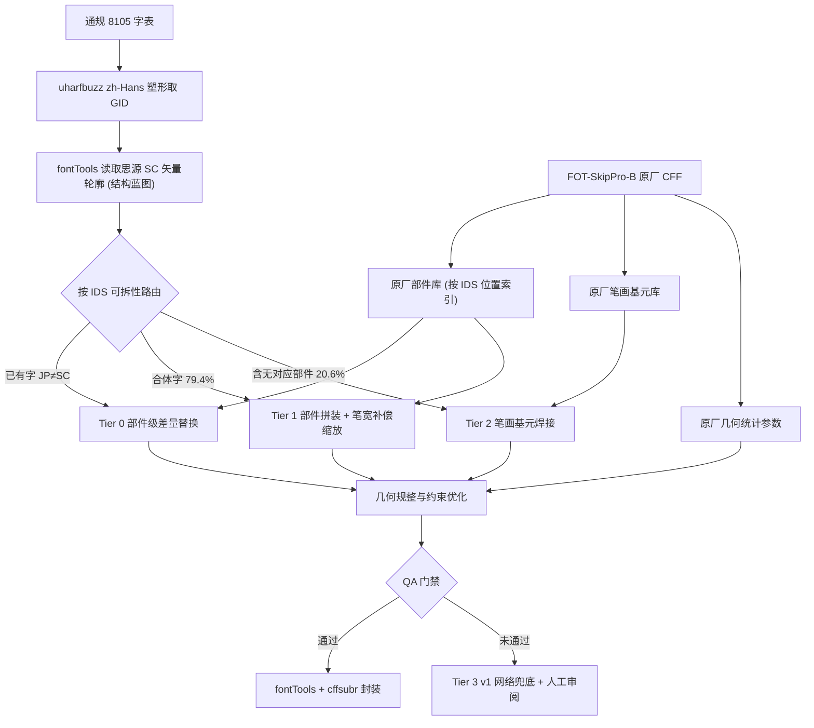

# CnS- 字体优化技术方案 v2.0（原生矢量优先与几何笔理约束架构）

> [!IMPORTANT]
> **核心目标（v1 → v2.0）**
> 1. **目标字集**：《通用规范汉字表》全集 **8,105 字**（数据源 [`shengdoushi/common-standard-chinese-characters-table`](https://github.com/shengdoushi/common-standard-chinese-characters-table)），并把原库已有、但**日标字形 ≠ 国标字形**的共码字纳入陆标化队列。
> 2. **生成范式**：放弃「整字栅格化 → 神经网络涂抹 → 等值面描边」的有损链路，改为 **以思源 SC 矢量为结构蓝图、以原厂 `CFF` 部件/笔画为形状来源** 的矢量优先管线；SkipPro-B 的「风格」不再由网络隐式学习，而是**从原厂 7,912 字中统计出显式几何参数**（干线弧高、端头张角、笔宽分布等），作为约束与优化目标。

---

## 0. 审计修订记录（v2.0 → v2.0.1）

v2.0 初稿中有若干数字为估计值或未经验证的论断。本版逐条用脚本对 `FOT-SkipPro-B.OTF`、Noto CJK、cjkvi-ids、MakeMeAHanzi 做了实测，修订如下：

| # | 初稿论断 | 实测结果 | 处理 |
| :-: | :--- | :--- | :--- |
| 1 | 单字锚点硬门禁 `≤ 95` | 原厂 CJK 字形 on-curve 点数 **p50=154 / p90=226 / p99=298 / max=380**，`> 95` 的占 **88.7%** | 门禁会误杀绝大多数原厂字，**删除绝对上限**，改为按复杂度分桶的相对门禁（§5） |
| 2 | 原厂 `紅` 右侧 `工` 仅 16 个锚点 | `紅` 共 5 个轮廓；`工` 单轮廓 **47** 个 on-curve 点（39 段 curveTo），16 点的是 `糸` 的一个子轮廓 | 修正示例；问题的本质不是点数总量，而是**点落在了直边中段**（§4.2） |
| 3 | 原厂直线干 = 「四角点 + 单段内凹收腰曲线」，收腰量 `1.2~4.0 UPEM` | 长度 >100u、偏角 <2° 的边：**lineTo 57% / curveTo 43%**；curveTo 弧高 **p10=0.4u / p50=0.9u / p90=1.6u**，其中 **96.5% 向内凹（收腰）** | 「单段 + 内凹」得到证实，但量级是 ~1u 而非 1.2~4u；阈值改用实测分布 |
| 4 | 中日异形字按 IoU 分三档：1,686 同形 / 1,808 显著 / 510 轻度 | 用 HarfBuzz 塑形比较字形 ID（GID）：宋体 **2,324**、黑体 **2,549**、并集 **2,623** 字 JP≠SC；两者都同形的仅 **1,381** 字 | 改用 GID 精确判定；IoU 只作排序辅助（栅格 IoU 对 2~3px 笔画位移过敏） |
| 5 | 生成规模 ≈ 6,200，另保留 1,900+ 原厂字 | 4,101（缺字）+ 2,623（JP≠SC）= **6,724 上限**；原样保留 **1,381** | 修正，并加入「细节差异是否替换」的审阅策略（§2.3） |
| 6 | 合体字 ~78% / 独体字 ~22%（估计） | cjkvi-ids 顶层拆分：**64.3%** 各部件均有同位置原厂捐献件或属母偏旁库；**15.1%** 需从独体字缩放借件；**20.1%** 含原库无对应的部件；**0.5%** 无 IDS/原子字 | 用实测比例；上述为**上限**（尚未过滤捐献件本身是日标写法的情况） |
| 7 | `道` 的差异是「走之底一二点」，`骨` 是「下月内钩方向」 | 渲染比对：`道` 两标准均为一点，差异在 `辶` 的折撇笔形；`骨` 的差异在**上部**内框开口方向 | 修正示例描述 |
| 8 | Tier 2 依赖 MakeMeAHanzi 拆笔 | MMH 仅覆盖通规 **6,866 / 8,105**、缺字 **3,068 / 4,101（74.8%）**；其轮廓源自文鼎楷体，几何与 SkipPro-B / 思源差异大 | MMH 降级为笔顺/笔数/笔形标签来源，**位置一律取思源 SC**；未覆盖字走思源 SC 矢量骨架化兜底（§3.3） |
| 9 | 原厂单笔画库「100% 纯原厂」 | SkipPro-B 中相交/相接笔画已合并为同一轮廓（如 `工` 三笔一个轮廓），拆笔必须在交接处**新造**截断边 | 如实标注：独立轮廓笔画可无损提取，相接笔画需半自动切分 + 人工抽检 |
| 10 | TPS「无穷阶光滑、不新增锚点、保字重」 | 对控制点施加变换确实不增点、直线仍为直线；但**非均匀变换必然改变笔宽**，「沿中轴保宽」需要额外的补偿步骤 | 改为成熟做法：**分轴缩放 + 笔宽补偿偏移**（§3.2） |
| 11 | 公式：$\mathcal{L}_{\text{stem}}$ 混用二阶导与曲率、积分变量未定义；把曲率全变分称作「欧拉弹性」 | 数学表述错误 | 重写 §4：直干改为**硬约束**，弧线用曲率变差能量，弹性能 $\int\kappa^2 ds$ 单列 |
| 12 | 母偏旁每个 15~35 锚点 | 原厂 `糸`（`紅` 左部）4 个轮廓共 **73** 点 | 删除固定数字，改为「与原厂同类部件点数同量级」 |
| 13 | 未提 | **新发现 v1 缺陷**（见 §1 第 7 条）：远程训练机 Pillow 无 `raqm`，思源骨架全部渲染成**日标**字形 | 写入复盘；v2 统一用 `uharfbuzz` 取 GID + `fontTools` 取矢量 |
| 14 | 未提 | 版权合规风险（§6） | 新增 |

---

## 1. v1（栅格 SDF 版）缺陷复盘

| # | 现象 | 根因 |
| :-: | :--- | :--- |
| **1** | **轮廓几乎全是曲线、直边上布满节点**（图一 `红`） | ① 矢量 → 256px 栅格 → 网络 → 等值面，往返引入亚像素波纹；② v1 描边容差 `0.3 UPEM` 远小于单像素（≈2.3 UPEM），像素台阶被逐一拟合；③ `红` 右部 `工` 在原库 `紅` 中本有现成的独立轮廓，却被重画 |
| **2** | **中日异形字未处理**（图三 `微`、`言`） | 只按「码位缺失」筛选，未比较已有码位的字形标准 |
| **3** | GB2312 覆盖面不足 | 改为通规 8,105 字 |
| **4** | **独体字易出问题**（图二 `伞 丌 习 乡 卫`） | 笔画稀疏、留白大，局部卷积感知不到长笔画的整体刚性 → 粗细波动、折角软化 |
| **5** | **未学到「直」与「弧」** | 损失只有逐像素 L1(SDF) + 一阶 Sobel + PatchGAN；一阶项对曲率震荡不敏感，PatchGAN 反而鼓励高频边缘纹理 |
| **6** | 结构由网络处理属于冗余 | 结构在思源 SC 矢量中是已知量，无需 Content Encoder 重新推断 |
| **7** | **骨架字形标准错误**（审计新发现） | `NotoSerif/SansCJK-VF.ttc` 各 face 共享同一 `cmap`，**原始 cmap 字形即日标字形**（2,324 个差异字中 raw==JP 2,324、raw==SC 0），陆标字形只能经 `GSUB locl` 得到。远程训练机 Pillow 无 `raqm` → 走 basic layout、不执行 GSUB → **训练和推理骨架全是日标字形**；v1 生成的 2,983 个 GB2312 字中有 **574 个**的骨架本身就是日标写法（如 `亏 扒 扔 归 甩 宁 奶 巩 达 丢 迁 优 关 异 运`）。本机虽有 `raqm`，但代码未传 `language`，字形随系统 locale 而定，两台机器行为不一致 |
| **8** | QA 门禁失效 | v1 的 2,983 字中 2,838 字被标记异常，阈值未用原厂字分布标定，失去区分度 |

> [!WARNING]
> 由于第 7 条，**v1 产出的 `CnS-SkipPro-B-GB2312-SC.otf` 不应视为陆标字体**，v2 需全部重新生成。

---

## 2. 通规 8,105 字盘点

### 2.1 缺字统计

| 字表 | 字数 | 原库已有 | **原库缺失** |
| :--- | :-: | :-: | :-: |
| 一级 | 3,500 | 2,350 | **1,150** |
| 二级 | 3,000 | 1,356 | **1,644** |
| 三级 | 1,605 | 298 | **1,307** |
| 合计 | 8,105 | 4,004 | **4,101** |

### 2.2 已有 4,004 字的中日字形差异（GID 精确判定）

判定方法：`uharfbuzz` 对单字塑形，face 0 + `language=ja` 与 face 2 + `language=zh-Hans` 的输出 GID 是否相同。

| 类别 | 字数 | 说明 |
| :--- | :-: | :--- |
| 宋体、黑体均同形 | **1,381** | 原厂轮廓原样保留 |
| 至少一种参考字体 JP≠SC | **2,623** | 宋体 2,324 / 黑体 2,549 / 交集 2,250；按字表：一级 1,461、二级 954、三级 208 |

典型差异（上排日标、下排陆标，思源宋体 Bold 实测）：`言` 首笔短横 vs 点；`直` 左下 `乚` 连笔 vs 竖与底横分离；`令` 下部写法；`骨` 上部内框开口方向；`道` 中 `辶` 的折撇笔形；`微` 中部部件笔形。

### 2.3 差异字的替换策略（需决策）

2,623 字里既有 `直 言 令` 这类结构差异，也有 `山 八 入 之 广` 这类仅笔端/接触关系的细微差异。用合成字替换原厂字有质量风险，尤其一级字表就有 1,461 字。建议：

1. **按部件归并**：差异大多来自少数高频部件（`言` 首笔、`令` 下部、`骨` 上部、`辶`、`山` 等）。先建「日标部件 → 陆标部件」对照表，每个部件只修一次，再传播到所有含该部件的字。
2. **分级处理**：结构差异（笔数、连断、笔向变化）默认必修；细节差异生成对照图供人工逐批确认。
3. **双版本输出**：默认 `cmap` 指向陆标字形；同时可选保留原厂日标字形，通过 `locl`（`JAN`）切换。

**生成规模上限**：4,101 + 2,623 = **6,724** 字。

---

## 3. v2.0 架构：思源 SC 矢量蓝图 + 原厂矢量形状

### 3.1 前置：可复现的字形与结构数据

- **字形获取**：不再用 Pillow 渲染骨架。统一用 `uharfbuzz`（显式 `language="zh-Hans"` / `"ja"`）取 GID，再用 `fontTools` 读取该 GID 的矢量轮廓。结果与平台、`raqm`、系统 locale 无关，且全程是矢量。
- **结构数据**：`cjkvi-ids`（取 `[G]` 标记的分解）提供部件树；MakeMeAHanzi 仅用于笔数、笔顺与笔形标签（覆盖缺字 74.8%），不用其坐标。

### 3.2 Tier 0 / Tier 1：部件级矢量拼装（主力路径）

覆盖 Tier 0 全部 2,623 字及缺字中的 3,256 字（2,636 有同位置捐献件或属母偏旁库 + 620 需缩放借件）。

1. **同位置捐献件优先**：例如 `红 = ⿰纟工`，右部 `工` 优先取原库中同为左右结构右部的 `工`（如 `紅`、`江`），而不是独体 `工` 硬压。`紅` 的 `工` 本身是独立轮廓（47 点），可零损失提取。
2. **捐献件字形标准过滤**：捐献字若属于 2,623 个 JP≠SC 字，需先确认其差异不在被借部件上，否则会把日标写法带入新字。
3. **母偏旁库**：约 50 个陆标简化/异形偏旁（`讠 钅 纟 饣 车 贝 见 页 马 鸟 门 风 韦 齿 龙 鱼`，以及 `辶`、`言` 首点、`令` 下部等）。用原厂真实部件或笔画组装后人工精修定型，点数与原厂同类部件同量级（参考：`紅` 的 `糸` 共 73 点）。这批是全项目质量上限所在，值得投入人工。
4. **跨比例借件的笔宽补偿**：直接把独体 `吾` 横向缩到 0.65 倍放进 `语` 右部，竖画会变细 35%。采用字体设计中成熟的做法：**分轴缩放 → 按缩放比对轮廓做横、纵分轴偏移，恢复原笔宽**（与 Glyphs「Offset Curve」分轴偏移同理），偏移后经 §4.2 清理器去除多余节点。缩放比超出阈值（如 <0.6）时转人工。
5. **定位**：部件包围盒取自思源 SC 对应部件区域，再按原厂同类结构的统计比例（如 `⿰` 左右宽度比）微调，避免完全照搬思源的空间分配。

### 3.3 Tier 2：笔画基元焊接（原库无对应部件的字）

覆盖缺字中的 845 字（825 含无对应部件 + 20 无 IDS），图二的 `伞 丌 习 乡 卫` 属于此类。

1. **笔画基元库构建**：
   - 只从 1,381 个**中日同形**的原厂字中提取，避免引入日标笔形；
   - SkipPro-B 中不与其他笔画相接的笔画（点、多数撇捺、孤立短横）是独立轮廓，可**无损提取**；
   - 相接笔画已合并在同一轮廓里，需按 MMH 笔画分区在交接处切分并补出截断边，**属新造几何**，采用半自动 + 人工抽检；
   - 笔形分类按中轴折线几何聚类，参照《GB13000.1 字符集汉字折笔规范》约 30 类。
2. **目标字结构**：笔画数量与类型取自 MMH；**每笔的端点和走向取自思源 SC**（对思源黑体 SC 轮廓做中轴提取并与 MMH 笔序匹配）。MMH 未覆盖的字直接对思源黑体 SC 做骨架化分笔。
3. **变形规则**：检索到的原厂笔画只做**端头刚性保持 + 中段拉伸**（端头的切角、钩尖原样平移旋转，只伸缩中间直段），弧形笔画额外允许低阶曲率调整。不使用会改变笔宽的整体非均匀变换。
4. **焊接**：`skia-pathops` 布尔并集。交接处会是通用形状而非原厂设计师的定制接口，焊接后需按原厂统计的交接形态（如横竖相交处的处理）做局部修整。
5. **示例（待 M2 验证）**：`丌` = 原厂平长横 + 竖撇 + 垂露竖；`习` 外框横折钩取自原厂 `羽` 右部或 `司`、内部点提取自 `冫`；`伞` 顶盖取自 `会`/`全` 的人字头。

### 3.4 Tier 3：兜底

Tier 0–2 未通过 QA 的字，用 v1 局部 SDF 网络（**修正为 zh-Hans 骨架输入**）生成，再经 §4.2 清理器规整，全部进入人工审阅队列。

---

## 4. 几何约束与优化目标（替代像素损失）

v1 的问题是网络只被要求「像素像」，从未被约束「直的要直、弧的要顺」。v2 不再训练网络学风格，而是**直接对贝塞尔控制点做约束优化**：目标 = 数据项（贴合 Tier 0–2 给出的目标形状） + 几何先验；先验的参数全部从原厂字统计得到。

### 4.1 约束与能量项

**(a) 干线硬约束（横、竖、折干的长边）**——用表示方式直接排除波浪：
- 每条长边只允许 **1 段**：`lineTo`，或一段 `curveTo`；
- 若为曲线：弧高 $\delta \in [0.4,\ 1.6]$ UPEM（原厂 p10–p90），且**向内凹**（原厂 96.5%）；两控制柄沿弦方向、对称，保证段内无拐点。

**(b) 弧线笔画（撇、捺、钩、弯）的光顺能量**——设轮廓弧长参数为 $s$，曲率为 $\kappa(s)$：

$$E_{\text{fair}} = \int \left(\frac{d\kappa}{ds}\right)^2 ds$$

并作为硬检查：单笔画的同一侧轮廓内，$\kappa$ 不得出现原厂同类笔画中不存在的符号翻转。可选加入弹性能 $E_{\text{el}} = \int \kappa^2\, ds$ 抑制过度弯曲。

**(c) 笔宽剖面**：沿笔画中轴测法向宽度 $w(s)$，与原厂同类笔画的统计剖面比较——横竖干两端略张、中段平稳；撇画 $\frac{dw}{ds} \le 0$ 单调收细。端头张量等参数取原厂实测分布，而非手设常数。

**(d) 角点稀疏**：切向角跳变只允许出现在起收笔切角、折角、钩尖处，其余位置要求 $G^1$ 连续（弧段之间 $G^2$）。

**数据项**：生成轮廓与目标形状采样点间的 Chamfer 距离；如需与栅格参考比较，可接 DiffVG 可微光栅化，但不是必需。

### 4.2 轮廓清理器

1. **长直边合并**：近水平/近垂直（±2°）的长边，若中间节点可删且合并后误差 <1.0 UPEM，合并为单段；弧高 <0.4u 改为 `lineTo`，0.4–1.6u 保留为单段内凹曲线，>1.6u 视为非干线不处理。
2. **共线微弧合并**：相邻曲线段合并后最大法向误差 <1.0 UPEM 则合并。
3. **节点分布检查**：直边中段节点数应为 0；节点应集中在端头、折角、交接处——这才是图一中原厂与 v1 的本质差别。

---

## 5. QA 门禁（阈值来自原厂实测）

| 维度 | 门禁 | 依据 |
| :--- | :--- | :--- |
| 1. 节点分布 | 长直边中段节点 = 0；整字点数 ≤ 同复杂度桶（按思源 SC 对应字点数分桶）原厂字的 p95 | 原厂 p50=154、p99=298，绝对上限不可用 |
| 2. 干线形态 | 长直边单段；曲线弧高 0.4–1.6u 且内凹 | 原厂 p10–p90 / 96.5% 内凹 |
| 3. 弧线光顺 | 单笔画同侧无异常曲率符号翻转；$E_{\text{fair}}$ ≤ 原厂同类笔画 p95 | 原厂统计 |
| 4. 陆标合规 | 与 zh-Hans 思源轮廓逐部件比较包围盒与连通数 | GID 精确判定 |
| 5. 覆盖 | 8,105 / 8,105 | 通规全集 |
| 6. 复用率 | 统计并报告原厂轮廓直接继承比例（M1 后定目标值） | 不预设数字 |
| 7. 人工抽检 | 各 Tier 按比例抽检；Tier 3 全检 | — |

先用原厂字自身跑一遍门禁，**误报率应接近 0**，以此校验阈值（避免重蹈 v1 「2,983 字标记 2,838 字」的覆辙）。

---

## 6. 风险与合规

> [!CAUTION]
> `FOT-Skip Pro` 是 Fontworks 的商业字体。其使用许可通常不允许修改后再分发，也不允许公开分发字体文件本身。本仓库目前公开托管了原字体与派生字体，建议**确认授权或将仓库设为私有**后再继续。

- **思源/Noto CJK**：SIL OFL 1.1。v2 只取其结构位置，不把思源轮廓拷进产物；若 Tier 3 或其他环节引入思源轮廓，派生字体须遵守 OFL。
- **cjkvi-ids**：GPLv2（源自 CHISE）；**MakeMeAHanzi**：图形数据为 Arphic Public License。两者仅作构建期参考数据，不随字体分发。
- **技术风险**：相接笔画切分与 Tier 2 焊接接口是最难自动化的部分，需预留人工精修工作量。

---

## 7. 实施路线图

1. **M1 数据与基建**
   - 用 `uharfbuzz` + `fontTools` 替换 Pillow 骨架渲染；导出 4,101 缺字表、2,623 差异字表（附 JP/SC 对照图供审阅）。
   - 建立 IDS 部件索引、同位置捐献件库（含字形标准过滤）、原厂几何统计参数。
   - 用原厂字校准 QA 门禁。
2. **M2 靶向验证**（先跑通再铺量）
   - 合体：`红 语 银 饭`；独体：`伞 丌 习 乡 卫 专 书 东`；异形：`言 直 令 骨 微 道`。
   - 输出节点级对比图 + 每字 QA 指标，与原厂同类字并排检查。
3. **M3 母偏旁定型与全量合成**：约 50 个母偏旁人工精修 → Tier 0/1/2 → Tier 3 兜底。
4. **M4 审阅与发布**：人工审阅、`cffsubr` 压缩、陆标默认 + 可选日标 `locl` 双字形封装。
